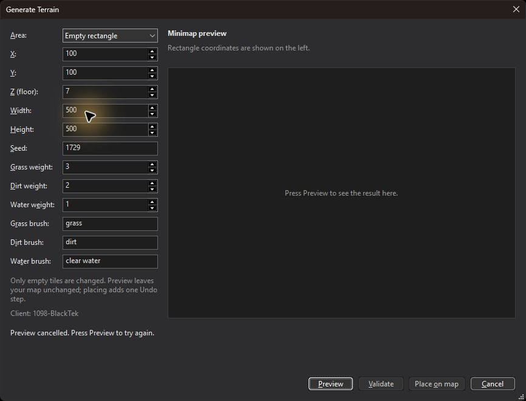

# G1 — anulowanie przygotowania Preview

## Powtórzenie po przeniesieniu kontroli wstępnej przed alokację

Przebieg `g1-cancel-post-preflight-rme-20261104` na kanonicznym EXE `15c25557…` uzyskał **PASS_G1_GUI_IN_FLIGHT_CANCEL_ONLY**. Cancel dotarł w trakcie pracy 500×500 po 188,9 ms od uruchomienia Preview. Obserwator potwierdził stan anulowania po kolejnych 50,7 ms. Validate i Place były nieaktywne. Ponowienie opublikowało seed 1728 i przeszło Validate. Mapa, sentinel i historia pozostały bez zmian we wszystkich cyklach.

| Pełny Preview 500×500 | Do READY [ms] | Maks. przerwa GUI [ms] | Szczyt WS [MiB] | Przyrost WS [MiB] |
|---|---:|---:|---:|---:|
| Ponowienie, seed 1728 | 1243,0 | 167,0 | 799,1 | 80,9 |
| Seed 1729 | 1279,5 | 168,1 | 800,1 | 80,4 |
| Seed 1729 | 897,4 | 157,2 | 800,5 | 79,6 |

Największa przerwa GUI to 168,1 ms wobec 180,9 ms w pierwszym przebiegu etapowym i 546,1 ms w bazie synchronicznej. Przyrost working set pozostaje zbliżony do obu poprzednich prób. Trzy cykle pozwalają potwierdzić rząd wielkości. Różnica między buildami etapowymi nie dowodzi przyspieszenia po zmianie kontroli wstępnej.

Przebieg zakończył się z kodem 0 i pustym stderr. Verifier potwierdził 421 obiektów, 421 wejść kompilacji, niezmienione assets i 14 rekordów CSV. W tym przebiegu nie mierzono Place ani nie powtarzano zapisu i ponownego odczytu.

[Surowy CSV](benchmarks/g1-ui-cancel-post-preflight-20261104.csv) ma SHA-256 `12c8b07cf3fa8e6b8f6d604c4a1fae4817d1c2b0e014f1f10e2f6b87dac38681`. [Zrzut udanego ponowienia](screenshots/g1-cancel-post-preflight-20261104.jpg).

## Pierwszy przebieg etapowy

2026-11-04. **PASS_G1_GUI_IN_FLIGHT_CANCEL_ONLY**. Pełne **G1 IN PROGRESS**.

## Natywny test 500×500

W prywatnym profilu 1098-BlackTek otwarto generator na syntetycznej mapie z jednym sentinelem poza obszarem. Obserwator potwierdził, że polecenie Cancel dotarło w stanie „Preparing preview”, po 214,8 ms od rozpoczęcia Preview. Po kolejnych 52,5 ms od polecenia timer zaobserwował stan „Preview cancelled” z nieaktywnymi Validate i Place. Przez cały przebieg mapa zachowała tożsamość, rewizję, pojedynczy sentinel i czysty stan, a historia pozostała pusta.

Ponowienie w tym samym dialogu pokazało 250 000 zmian dla seeda 1728 i przeszło Validate. Anulowany seed 1729 nie pojawił się jako wynik tego żądania. Następne dwa pełne cykle użyły bazowego seeda 1729.



[Zrzut podglądu po ponowieniu z seedem 1728](screenshots/g1-cancel-retry-20261104.jpg)

## Pomiar

| Cykl 500×500 | Preview do READY [ms] | Maks. przerwa GUI w Preview [ms] | WS przed [MiB] | Szczyt WS [MiB] | Przyrost WS [MiB] | WS po Cancel i sekundzie [MiB] |
|---|---:|---:|---:|---:|---:|---:|
| Ponowienie, seed 1728 | 989,4 | 170,5 | 716,1 | 797,4 | 81,3 | 717,4 |
| Seed 1729 | 1426,5 | 154,0 | 718,3 | 798,3 | 80,0 | 718,0 |
| Seed 1729 | 1566,4 | 180,9 | 719,0 | 798,8 | 79,9 | 718,7 |
| Baza, trzy cykle 1729 | 523,5–528,4 | 536,5–546,1 | 724,2–726,2 | 804,6–805,6 | 79,3–80,5 | 724,5–728,8 |

Największa przerwa GUI podczas pełnego Preview spadła z 546,1 do 180,9 ms. Czas oczekiwania na READY wzrósł. Przyrost working set pozostał zbliżony do bazowego, a niższy bezwzględny szczyt wystąpił przy niższym poziomie startowym procesu. W przerwanym Preview szczyt WS wyniósł 774,3 MiB, o 60,7 MiB powyżej startu. Największe odstępy timera wyniosły 66,5 ms do polecenia Cancel i 86,9 ms w oknie jego obsługi.

Po pełnym Preview Validate było obserwowane po 89,2–94,6 ms, a zamknięcie po Cancel po 111,1–113,8 ms. Maksymalne przerwy timera w tych oknach wyniosły odpowiednio 129,8 i 134,7 ms. Czasy obejmują dojście do odczytu timera. Próbnik pamięci miał maksymalny odstęp 6,8 ms. Próba obejmuje jedną syntetyczną mapę źródłową i dwa seedy, więc porównanie opisuje ten przebieg.

[Surowy CSV z 14 rekordami, w tym private commit](benchmarks/g1-ui-cancel-20261104.csv). SHA-256 `64e351f6f08074c8f3ae42c701a0883e55492f232a9a005f37871a949b715cb1`.

## Granice weryfikacji

`build_ninja.bat` ukończył Windows x64 Release. Przebieg `g1-cancel-final-rme-20261104` zakończył się z kodem 0, pustym stderr i niezmienionymi wejściowymi assets. Niezależny verifier sprawdził 421 obiektów i 421 wejść kompilacji oraz oba EXE i hash CSV. Wcześniejszy przebieg `g1-cancel-rme-20261103` przekroczył limit czasu przed wykonaniem scenariusza i nie został zaliczony.

W tym przebiegu nie testowano zamknięcia okna ani zmiany wejścia podczas pracy, odmów po zmianie celu, Place/Undo/Redo na tym binarium, gęstych map, wycieków ani round-trip OTBM z companionami. Historyczne testy rdzenia i G0 zachowują swój wcześniejszy zakres.

## Implementacja

Dialog posiada jedną kontynuację przygotowania i timer jednorazowy. Snapshot żywej mapy, rdzeń semantyczny, resolver i operacje sandboxa wykonują się na głównym wątku. Pętla GUI odzyskuje sterowanie między etapami i między porcjami pętli sandboxa. Próg 8 ms dotyczy sprawdzanych punktów podziału sandboxa. Snapshot, początkowe kontrole, końcowa walidacja i zwalnianie danych mają odrębny koszt.

Cancel podczas pracy usuwa kontynuację i jej częściowy wynik. Zmiana wejścia robi to samo. Zamknięcie dialogu zwalnia zadanie przed zamknięciem okna. Timer wznawia wyłącznie bieżącą kontynuację i nie przenosi wyniku, więc usunięte zadanie nie może później opublikować podglądu. Każde wznowienie sprawdza bieżący cel, sandbox sprawdza rewizję assets, a publikacja nadal wymaga walidacji celu i fingerprintu.

Wariant synchroniczny używa tej samej implementacji etapów. Przygotowanie zachowuje jeden licznik budżetu. Place korzysta z istniejącej ścieżki atomowej publikacji diffu i historii.

## Odtworzenie

```text
rtk proxy <PY> docs/procedural/smoke/g1_run_dialog_probe.py local-data/procedural-smoke/NEW_RUN local-data/procedural-smoke/g0-reference-profile-20261030/data local-data/procedural-smoke/g0-reference-profile-20261030/config.toml --cancel-preview
rtk proxy <PY> docs/procedural/smoke/g1_verify_dialog_probe.py local-data/procedural-smoke/NEW_RUN --cancel-preview
```

`<PY>` to `C:/Users/Sorky/.cache/codex-runtimes/codex-primary-runtime/dependencies/python/python.exe -X utf8`. Po utworzeniu syntetycznej mapy otwórz Map → Generate terrain, ustaw oba wymiary na 500, uruchom Preview i naciśnij Cancel podczas przygotowania. Po komunikacie o anulowaniu ustaw seed 1728 i wykonaj Preview → Validate → Cancel. W dwóch kolejnych dialogach wykonaj pełne cykle z domyślnym seedem 1729 i wymiarami 500×500. Obserwator rejestruje stan źródła i historii, odstępy timera GUI oraz working set i private commit procesu. Porównanie odnosi się do [pomiaru bazowego](G1_RESOURCES.md).
