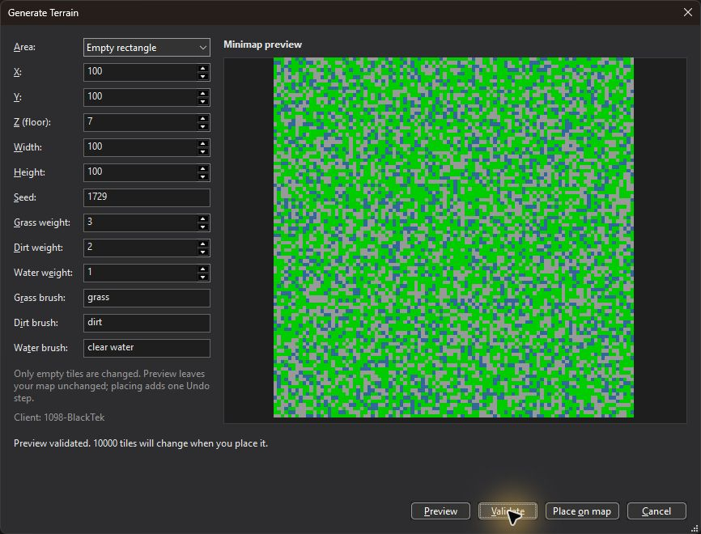

# G1 — native terrain generator dialog

Update 2026-11-03: [G1_DIALOG_MATRIX.md](G1_DIALOG_MATRIX.md) adds GUI 500×500, mask with holes, and selected refusals on same product code. The report below preserves scope of first 100×100 test.

2026-11-03: **PASS_G1_NATIVE_DIALOG_100_ONLY**. Full **G1 IN PROGRESS**. G2 not started.

Menu **Map → Generate terrain…** opens modal dialog: area/rectangle or current selection, coordinates, seed, three weights, and brush names. Preview prepares one own result, Validate rechecks its source, and Place on map passes concrete diff to existing DrawOperations and one Undo action. Cancel discards result. Each input change immediately removes old result and disables Place/Validate. Generation core, commit, or history not changed.

## Actual screenshot



This is **minimap of concrete tiles of prepared result**, with colors from existing TileColorCalculator. It is not sprite renderer. Minimal preview with §5.4 of project plan allows it. Does not read active map or client during paint; bitmap arises from own preview and snapshot. Screenshot from real native window of private test application, after Validate. Original JPEG returned by computer-use saved without edits.

[Screenshot after resize to minimum size](screenshots/g1-dialog-minimum-20261103.jpg). In checked environment explanations, client, status, and all buttons visible; minimap rescales on resize. Fixed label creation order, their names in UIA tree, and mnemonic collisions. Alt+S and Alt+P checked. Other DPI and full screen reader not tested.

## Codex independent verification

Canonical `cmd /c build_ninja.bat`: **exit 0**, log `local-data/procedural-smoke/g1-dialog-final-canonical-20261103.log`.

Private normal-entry probe `g1-dialog-final-rme-20261103`: **exit 0**, normal close, empty stderr, unchanged curated assets and sources. Test opens only synthetic maps in memory. Operator computer-use performed real menu and button commands; C++ observer does not replace those with direct handler calls.

| Check | Result |
|---|---|
| Invalid seed `not-a-seed` → Preview | Readable error, no source/history change |
| Seed 1729, area 100×100, weights 3/2/1 | Preview ready, 10,000 changes; map, revision, and history unchanged |
| Validate | Recheck result and current source; map unchanged |
| Change seed to 1728 | Result removed; Validate/Place disabled |
| Return to 1729, Preview, click Cancel | Source and history unchanged |
| Reopen, Preview, Place | One history entry; each result tile matches independently prepared preview |
| Real Ctrl+Z | One Undo removes generation and restores source context |
| Real Edit → Redo | Result again matches tile by tile; protected sentinel preserved |

Log contains `DIALOG_INVALID_SEED_PASS`, `DIALOG_PREVIEW_PASS`, `DIALOG_VALIDATE_PASS`, `DIALOG_INPUT_INVALIDATION_PASS`, `DIALOG_CANCEL_PASS`, `DIALOG_GUI_COMMIT_PASS`, `DIALOG_GUI_UNDO_PASS`, `DIALOG_GUI_REDO_PASS`, `DIALOG_PASS`. Fingerprint of independent default result: `6839872153377310206`.

`g1_verify_dialog_probe.py` rechecked hashes of **421 RME objects**, 421 compile inputs (including PCH), observer module, both EXE, dialog inputs, and curated assets. From previous passed core probe only two earlier CPP menu changed; new dialog CPP comes separately. From earlier extended proof inputs only CMake adding dialog changed. Older 100/500 probe and fault injection remains historical evidence on earlier EXE; not marked as rerun of current GUI test.

Normal EXE SHA256: `f4f7332a79b3b21058fe5ae9eabb408480902f48a3a6b689ba2352804423940e`.

Probe SHA256: `10f221a93452f8e9127248d5e6e764de0ce9132ab577599c09257642f1d67945`.

Final `git diff --check` with normal repo config: exit 0. New sources/tests/report separately checked for trailing whitespace and placeholder chars. Integration stays on `feature/procedural-g1-core` in `C:/repo/remeres-map-editor-redux-master`; shared Claude worktree kept.

Main screenshot SHA256: `d7631a71bbc129e4638647d8ad689ce9c11f4bdfcf1e1c9070ff64cd53ed8bd0`.

Private probe link recorded two MSVC C4723 warnings in wxWidgets header `wx/msw/gdiimage.h:117–118` (potential divide by zero). Library not edited; runtime and resize in this trial passed. Not proof of no issues in all wx/GDI paths.

## Claude and integration

Claude implemented only two new files `source/ui/dialogs/terrain_generator_dialog.h/.cpp` in dedicated worktree, run `a064a4f3-aa6f-4e2c-9293-49ce9186bc52`. Full tracked worker diff remained identical to previous accepted state; only addition was these two read files. Codex performed menu integration, testing, and fixes after review: std::format/wxstr, disable Place for empty diff, full layout, labels/mnemonics, repaint and rewrap status, and bad_alloc handling of input conversion also in Validate/Place.

Read-only Claude review: `acedd784-5875-4970-ae8d-cf5afdb1a4a1`; no checkout change. Both report/stdout: completed/exit 0, no permission denials, empty stderr. Claude did not compile or test. Fixes after his review checked by Codex; not declared as re-reviewed by Claude.

First build `g1-dialog-canonical-20261103.log` passed, but `g1-dialog-rme-20261103` inspection revealed trimmed explanation/client. Scenario stopped by Cancel button before required steps; observer deliberately exited 8 / `First dialog UI sequence incomplete`. Entire run kept as **FAIL/incomplete**, no pass. After fixes new full build and separate full run described above. Completed G0 audits not restarted.

## Reproduction

After canonical build, with new directory NEW_RUN, run via `rtk proxy` Python from Codex runtime:

```text
<PY> docs/procedural/smoke/g1_run_dialog_probe.py local-data/procedural-smoke/NEW_RUN local-data/procedural-smoke/g0-reference-profile-20261030/data local-data/procedural-smoke/g0-reference-profile-20261030/config.toml
<PY> docs/procedural/smoke/g1_verify_dialog_probe.py local-data/procedural-smoke/NEW_RUN
```

`<PY>` = `C:/Users/Sorky/.cache/codex-runtimes/codex-primary-runtime/dependencies/python/python.exe -X utf8`. Between commands you must really execute UI scenario from table. Informational startup warning of private assets closed in same instance. Timeout leaves same instance for investigation.

## Remaining G1 scope

Not passed: GUI selection/refusals/faults, GUI 500×500, sprite view, or generator GUI save/reopen OTBM with all companions. Generation is synchronous with no yield: Cancel works between operations and after preparation, does not interrupt in-progress generation. Still needed: responsive scheduling/cancellation and whole-application/RSS measurements and coexistent results.

Product keeps at most one own result, frees previous before next Preview, uses at most 500×500. Limits 512 MiB preparation and 768 MiB transition/Undo are core policy estimates. Bitmap has separate limited allowance `7*width*height+64 KiB`, mask up to 1 MiB; GUI, C/DLL/GPU, source, assets, and remaining history not hard-covered by these limits. Displayed estimate of preview includes bitmap and mask, not RSS measurement.

Next steps: (1) GUI selection/refusals and 500×500, (2) responsiveness/cancellation and RAM, (3) full generator GUI/OTBM round-trip and final matrix. Shared uncommitted changes kept; no commit/push. forgotten.otbm/companions, maps, or user world not opened; Docker and database not touched.
