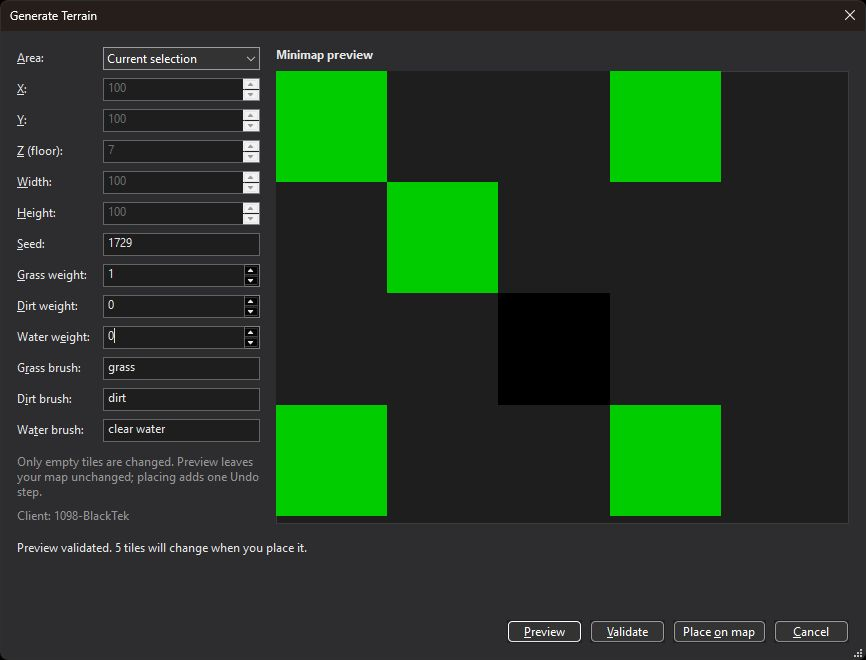

# G1 — GUI 500×500, dokładne zaznaczenie i odmowy

Aktualizacja 2026-11-03: komunikat Undo, opis małego zaznaczenia i centrowanie poprawiono w [kolejnym kroku UX](G1_DIALOG_UX.md). Poniższy raport zachowuje historyczny zakres oraz wcześniejsze otwarte pozycje.

2026-11-03: **PASS_G1_NATIVE_DIALOG_MATRIX_ONLY**. Pełne **G1 IN PROGRESS**; G2 nierozpoczęte. Ten krok wykonał Codex, **bez nowego uruchomienia Claude**.

## Chroniony kafel wewnątrz maski

2026-11-05. W prywatnym przebiegu `g1-protected-selection-20261105` kafel (203,203,7) miał grunt z UID 32101 i należał do pięciu pól dokładnego zaznaczenia. W natywnym RME przy seedzie 1729 i wagach 1/0/0 Preview zgłosiło cztery zmiany. Pierwsze Place odrzuciło nieaktualne zaznaczenie. Po ponownych Preview i Validate wykonano Place, Undo i Redo. Obserwator porównał dokładne członkostwo, cały kontekst z halo, zawartość chronionego kafla i tożsamość jego obiektu oraz gruntu. Log zawiera markery wykluczenia UID z diffu oraz zachowania go po każdej operacji. Runner zakończył się kodem 0 z pustym stderr.

Kanoniczny `build_ninja.bat` przeszedł. Starszy weryfikator selection-only przerwał na historycznej liście dopuszczonych zmian, która dla tego trybu nie uwzględnia etapowania Preview. Osobne porównanie potwierdziło zgodność 421 źródeł i 421 obiektów z manifestem przebiegu pomiarowego Place oraz zgodność aktualnych plików z manifestem. EXE produkcyjny ma SHA256 `15c25557…`. Wynik **PASS_G1_GUI_PROTECTED_SELECTION_ONLY** jest zapisany w `local-data/procedural-smoke/g1-protected-selection-20261105/protected-verification.json`. Próba dotyczy jednego chronionego kafla w małym zaznaczeniu i obejmuje tryb `--selection-only`.

Aktualizacja weryfikacji. Dla przebiegu runnera z `--selection-only` użyj `g1_verify_dialog_probe.py OUTPUT --protected-selection`. Ten tryb sprawdza manifesty i hashe aktualnego buildu oraz kolejność markerów ochrony UID 32101 i odmowy starego zaznaczenia. Na istniejącym przebiegu zapisał **PASS_G1_GUI_PROTECTED_SELECTION_ONLY** w `current-verification.json`. Próby na kopiach odrzuciły brak markera, błędny UID, duplikat markera i zmieniony EXE próbnika.


## Efekt

Rzeczywiste GUI obsłużyło Preview/Validate/Place i po jednym Undo/Redo dla **250 000 kafli**. Drugi przypadek użył pięciu pustych zaznaczonych pól bez flag selected w obszarze 4×4 z otworami. Place zmienił tylko te pięć pól; Undo przywrócił oryginalne obiekty kafli i dokładne membership, Redo odtworzył konkretny wynik bez zmiany otworów ani chronionego sentinela. Weryfikator porównuje pełny kontekst, w tym halo, z niezależnie przygotowanym wynikiem.




Zrzuty to oryginalne JPEG z natywnego computer-use, bez przeróbek. Pokazują minimapę konkretnych kafli, nie renderer sprite’ów. Wyłączone pola prostokąta w trybie zaznaczenia zachowują wcześniejsze wartości 100; rzeczywisty zakres 4×4 pochodzi z aktualnego zaznaczenia i jest potwierdzony komunikatem Preview oraz testem. Przy małej masce widoczne jest niedokładne centrowanie bitmapy; nie zaliczono doskonałości układu tego przypadku.

## Odmowy i limit Undo

| Próba GUI | Wynik |
|---|---|
| Current selection bez zaznaczenia | Odmowa; źródło i historia bez zmian |
| Nieznany ground brush | Odmowa; źródło i historia bez zmian |
| Wagi 0/0/0 | Odmowa; źródło i historia bez zmian |
| X=65535, zakres wychodzący poza mapę | Odmowa; źródło i historia bez zmian |
| Zmiana pięciu wybranych pól na inny zestaw pięciu o tych samych granicach, po Validate | Place odmówił; preview usunięte, źródło i historia bez zmian |
| Place 500×500 przy limicie Undo 40 MiB prywatnego profilu | Odmowa historii bez mutacji; następnie udana próba przy 512 MiB |

Zmianę membership wstrzyknął wyłącznie prywatny obserwator C++ po pierwszym Validate, bez modyfikacji payload kafli. Po odmowie przywrócił fixture; operator ponownie wykonał Preview/Validate/Place. Taki sam rozmiar i granice zaznaczenia nie wystarczyły do zaakceptowania starego wyniku. Tworzenie fixture i membership jest programowe; test nie zalicza gestów myszy tworzących zaznaczenie.

[Screen odmowy starego zaznaczenia](screenshots/g1-dialog-stale-selection-20261103.jpg). [Screen odmowy historii](screenshots/g1-dialog-history-refused-20261103.jpg).

Pierwsze Place 500×500 zostało poprawnie odrzucone przy `undo_mem_size=40`. Zachowano tę obserwację i cały proces; nie restartowano próby. Przez rzeczywiste **File → Preferences → General → Undo memory limit (MB)** ustawiono 512 wyłącznie w prywatnej instancji. `undo_size=400` pozostało bez zmian. Ponowne Preview/Validate/Place i Undo/Redo przeszły w tym samym procesie. Nie podniesiono automatycznie limitu produktu ani ustawień użytkownika. Dowód odmowy 40 MiB jest obserwacją operatora ze screenem i ciągłą kontrolą niezmienności w C++; nie ma osobnego programowego markera `MATRIX_HISTORY_REFUSED`. Szczegóły: `gui-observations.json`.

Komunikat odmowy historii jest obecnie ogólny i zaleca ponowne Preview. Samo Preview nie usunie zbyt niskiego limitu Undo — doprecyzowanie tego komunikatu pozostaje otwartą poprawką UX.

## Dowody techniczne

Kanoniczny Windows x64 `build_ninja.bat`: **exit 0**, aktualny log skopiowano do `local-data/procedural-smoke/g1-dialog-matrix-canonical-20261103.log`. Kod produkcyjny i normalny EXE są niezmienione względem poprzedniego zaliczonego kroku. Dodano `tests/test_procedural_dialog_matrix.cpp`; istniejący runner i verifier rozszerzono o jawny przełącznik `--matrix`.

`g1-dialog-matrix-rme-20261103`: **PASS / exit 0 / normalny shutdown / pusty stderr / curated assets i źródła bez zmian**. `g1_verify_dialog_probe.py --matrix` potwierdził 421 obiektów RME, 421 wejść kompilacji (w tym PCH), moduł testu, oba EXE i dodatkowe wejścia UI. Starsze CPP core oraz rozszerzone wejścia wcześniejszego dowodu core zachowały hashe; CMake różni się tylko wcześniejszym dodaniem dialogu. Dawnych audytów G0 ani fault injection core nie uruchamiano ponownie.

Normalny EXE SHA256: `f4f7332a79b3b21058fe5ae9eabb408480902f48a3a6b689ba2352804423940e`.

Prywatny probe SHA256: `b8096f74a40a2a65bce5985f975977c4b97f4ece68a5a26706b5fa9f0c9e84fa`.

Fingerprint wyniku 500×500: `9882819389089608359`; pięciu wybranych pól: `13253939497492653597`. Podgląd 500×500 pokazał **180,3 MiB estymaty** preview i obrazu. To estymata polityki, nie pomiar RAM/RSS. Niezależny wynik testu również zajmuje pamięć procesu testowego; nie jest drugim wynikiem produktu.

Log zawiera komplet markerów `MATRIX_500_PREVIEW/COMMIT/UNDO/REDO_PASS`, `MATRIX_SELECTION_PREVIEW/COMMIT/UNDO/REDO_PASS`, cztery odmowy wejść, `MATRIX_STALE_MEMBERSHIP_INJECTED`, `MATRIX_STALE_PLACE_REFUSED` i końcowy `MATRIX_PASS`. Po odmowie starych membership test wymaga nowego Preview i Validate przed udanym Place. Każda akceptacja musi mieć dokładnie jeden wpis historii. W gałęziach Undo/Redo sprawdzono także sentinel poza kontekstem.

Przy linkowaniu prywatnego probe pozostały dwa ostrzeżenia C4723 w nagłówku wxWidgets `gdiimage.h:117–118`, jak w poprzednim kroku. Nie zmieniano vendora; normalny runtime stderr jest pusty.

## Odtworzenie

```text
rtk proxy <PY> docs/procedural/smoke/g1_run_dialog_probe.py local-data/procedural-smoke/NEW_RUN local-data/procedural-smoke/g0-reference-profile-20261030/data local-data/procedural-smoke/g0-reference-profile-20261030/config.toml --matrix
rtk proxy <PY> docs/procedural/smoke/g1_verify_dialog_probe.py local-data/procedural-smoke/NEW_RUN --matrix
```

`<PY>` = `C:/Users/Sorky/.cache/codex-runtimes/codex-primary-runtime/dependencies/python/python.exe -X utf8`. Runner sam nie klika. W pierwszym dialogu wykonać cztery odmowy wejść, następnie ustawić (100,100,7), 500×500, seed 1729, wagi 3/2/1 i domyślne brushes. Wymagana rzeczywista walidacja, Place, Undo i Redo. Przy profilu 40 MiB należy udokumentować odmowę, zamknąć dialog, podnieść limit w prywatnych Preferences do 512 MiB i ponowić. Po `MATRIX_SELECTION_READY` otworzyć nowy dialog, Current selection, seed 1729 i wagi 1/0/0. Preview → Validate → po markerze wstrzyknięcia Place (odmowa) → Preview → Validate → Place → Undo → Redo. Obserwator kończy aplikację normalnie. Timeout pozostawia ten sam proces do inspekcji.

## Otwarte G1

Pozostają inne GUI odmowy/awarie (live, busy, brak klienta, wielopiętrowe zaznaczenie i wymuszone awarie alokacji w UI), responsywne anulowanie/harmonogram, RSS i współistnienie wyników oraz pełny generatorowy save/reopen OTBM ze wszystkimi companionami. Minimapę MVP odróżniono od sprite preview; tego ostatniego nie zaliczono.

Następne trzy zadania: (1) doprecyzować UI limitu Undo oraz prezentację małych zaznaczeń, (2) responsywność/anulowanie i pomiary RAM, (3) końcowy GUI/OTBM round-trip i macierz G1. Nie rozpoczynać G2. Wspólne niezacommitowane zmiany zachowano, bez commit/push; bez dostępu do map/world/DB/Dockera użytkownika i forbidden map/companionów.
