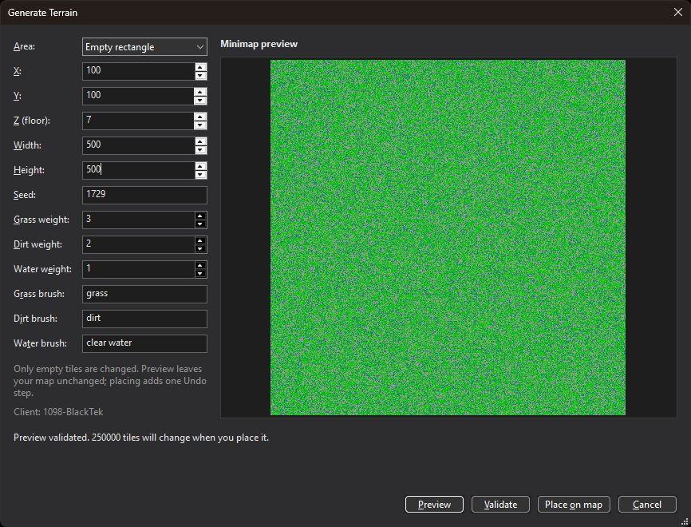

# G1 — GUI 500×500, exact selection, and refusals

Update 2026-11-03: Undo message, small selection description, and centering improved in [next UX step](G1_DIALOG_UX.md). The report below preserves historical scope and earlier open positions.

2026-11-03: **PASS_G1_NATIVE_DIALOG_MATRIX_ONLY**. Full **G1 IN PROGRESS**; G2 not started. This step performed by Codex, **without new Claude run**.

## Protected tile inside mask

2026-11-05. In private run `g1-protected-selection-20261105` tile (203,203,7) had ground with UID 32101 and belonged to five exact selection fields. In native RME with seed 1729 and weights 1/0/0 Preview reported four changes. First Place rejected stale selection. After rerun Preview and Validate, Place, Undo, and Redo were executed. Observer compared exact membership, full context with halo, contents of protected tile and its object identity and ground. Log contains UID exclusion markers from diff and preservation after each operation. Runner ended code 0 with empty stderr.

Canonical `build_ninja.bat` passed. Older selection-only verifier halted on historical allowed-changes list that for this mode does not account for Preview staging. Separate comparison confirmed 421 sources and 421 objects match the measurement run manifest and current files match the manifest. Production EXE has SHA256 `15c25557…`. Result **PASS_G1_GUI_PROTECTED_SELECTION_ONLY** is in `local-data/procedural-smoke/g1-protected-selection-20261105/protected-verification.json`. Trial concerns one protected tile in small selection and covers `--selection-only` mode.

Verification update. For runner run with `--selection-only` use `g1_verify_dialog_probe.py OUTPUT --protected-selection`. This mode checks manifests and hashes of current build and order of protection markers for UID 32101 and old selection refusal. On existing run recorded **PASS_G1_GUI_PROTECTED_SELECTION_ONLY** in `current-verification.json`. Trials on copies rejected missing marker, wrong UID, duplicate marker, and changed probe EXE.


## Effect

Real GUI handled Preview/Validate/Place and one Undo/Redo each for **250,000 tiles**. Second case used five empty selected fields without selected flags in 4×4 area with holes. Place changed only those five fields; Undo restored original tile objects and exact membership, Redo reproduced concrete result with no hole or protected sentinel change. Verifier compares full context, including halo, against independently prepared result.




Screenshots are original JPEG from native computer-use, no edits. Show minimap of concrete tiles, not sprite renderer. Disabled rectangle fields in selection mode preserve earlier values of 100; actual 4×4 range comes from current selection and confirmed by Preview message and test. With small mask inaccurate bitmap centering is visible; layout perfection for this case not passed.

## Refusals and Undo limit

| GUI trial | Result |
|---|---|
| Current selection without selection | Refused; source and history unchanged |
| Unknown ground brush | Refused; source and history unchanged |
| Weights 0/0/0 | Refused; source and history unchanged |
| X=65535, range outside map | Refused; source and history unchanged |
| Change five selected fields to different set of five with same bounds, after Validate | Place refused; preview removed, source and history unchanged |
| Place 500×500 at 40 MiB Undo limit of private profile | History refused without mutation; then successful at 512 MiB |

Membership change injected only by private C++ observer after first Validate, without tile payload modification. After refusal restored fixture; operator reran Preview/Validate/Place. Same size and selection bounds insufficient to accept old result. Fixture and membership creation is programmatic; test does not cover mouse gestures creating selection.

[Screen of old selection refusal](screenshots/g1-dialog-stale-selection-20261103.jpg). [Screen of history refusal](screenshots/g1-dialog-history-refused-20261103.jpg).

First 500×500 Place correctly rejected at `undo_mem_size=40`. Observation and entire process kept; run not restarted. Via real **File → Preferences → General → Undo memory limit (MB)** set to 512 only in private instance. `undo_size=400` unchanged. Rerun Preview/Validate/Place and Undo/Redo passed in same process. Product limit or user settings not auto-raised. Proof of 40 MiB refusal is operator observation with screen and continuous immutability check in C++; no separate programmatic `MATRIX_HISTORY_REFUSED` marker. Details: `gui-observations.json`.

History refusal message currently generic and recommends rerun Preview. Preview alone will not remove too-low Undo limit — clarifying this message remains open UX fix.

## Technical evidence

Canonical Windows x64 `build_ninja.bat`: **exit 0**, current log copied to `local-data/procedural-smoke/g1-dialog-matrix-canonical-20261103.log`. Product code and normal EXE unchanged from previous passed step. Added `tests/test_procedural_dialog_matrix.cpp`; existing runner and verifier extended with explicit `--matrix` switch.

`g1-dialog-matrix-rme-20261103`: **PASS / exit 0 / normal shutdown / empty stderr / curated assets and sources unchanged**. `g1_verify_dialog_probe.py --matrix` confirmed 421 RME objects, 421 compile inputs (including PCH), test module, both EXE, and additional UI inputs. Older core CPP and extended prior-core-proof inputs preserved hashes; CMake differs only by earlier dialog addition. No G0 audits or core fault injection re-run.

Normal EXE SHA256: `f4f7332a79b3b21058fe5ae9eabb408480902f48a3a6b689ba2352804423940e`.

Private probe SHA256: `b8096f74a40a2a65bce5985f975977c4b97f4ece68a5a26706b5fa9f0c9e84fa`.

Result fingerprint 500×500: `9882819389089608359`; five selected fields: `13253939497492653597`. Preview 500×500 showed **180.3 MiB estimate** of preview and image. This is policy estimate, not RAM/RSS measurement. Independent test result also takes test process memory; not second product result.

Log contains full markers `MATRIX_500_PREVIEW/COMMIT/UNDO/REDO_PASS`, `MATRIX_SELECTION_PREVIEW/COMMIT/UNDO/REDO_PASS`, four input refusals, `MATRIX_STALE_MEMBERSHIP_INJECTED`, `MATRIX_STALE_PLACE_REFUSED`, and final `MATRIX_PASS`. After old membership refusal test requires new Preview and Validate before successful Place. Each acceptance must have exactly one history entry. In Undo/Redo branches sentinel outside context also checked.

At private probe link two C4723 warnings in wxWidgets header `gdiimage.h:117–118` remain, as in previous step. Vendor not changed; normal runtime stderr is empty.

## Reproduction

```text
rtk proxy <PY> docs/procedural/smoke/g1_run_dialog_probe.py local-data/procedural-smoke/NEW_RUN local-data/procedural-smoke/g0-reference-profile-20261030/data local-data/procedural-smoke/g0-reference-profile-20261030/config.toml --matrix
rtk proxy <PY> docs/procedural/smoke/g1_verify_dialog_probe.py local-data/procedural-smoke/NEW_RUN --matrix
```

`<PY>` = `C:/Users/Sorky/.cache/codex-runtimes/codex-primary-runtime/dependencies/python/python.exe -X utf8`. Runner does not click itself. In first dialog execute four input refusals, then set (100,100,7), 500×500, seed 1729, weights 3/2/1, and default brushes. Real validation, Place, Undo, and Redo required. With 40 MiB profile must document refusal, close dialog, raise limit in private Preferences to 512 MiB, and retry. After `MATRIX_SELECTION_READY` open new dialog, Current selection, seed 1729, weights 1/0/0. Preview → Validate → after injection marker Place (refusal) → Preview → Validate → Place → Undo → Redo. Observer exits application normally. Timeout leaves same process for inspection.

## Open G1

Remain: other GUI refusals/faults (live, busy, no client, multi-floor selection, and forced allocation faults in UI), responsive cancellation/schedule, RSS and result coexistence, and full generator save/reopen OTBM with all companions. Minimap MVP distinguished from sprite preview; the latter not passed.

Next three tasks: (1) clarify UI Undo limit messaging and small selection presentation, (2) responsiveness/cancellation and RAM measurements, (3) final GUI/OTBM round-trip and G1 matrix. Do not start G2. Shared uncommitted changes kept, no commit/push; no access to user maps/world/DB/Docker and forbidden map/companions.
