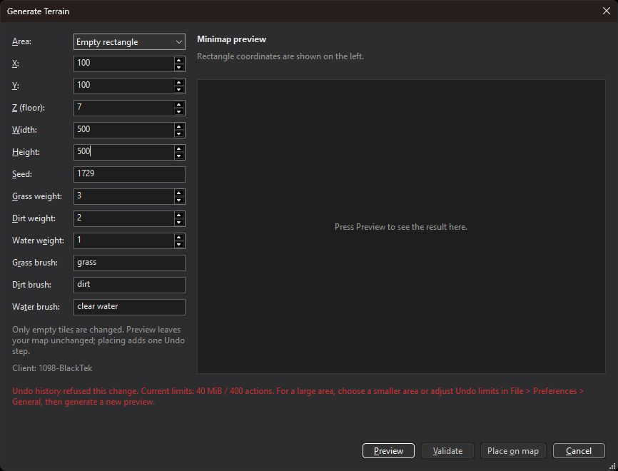
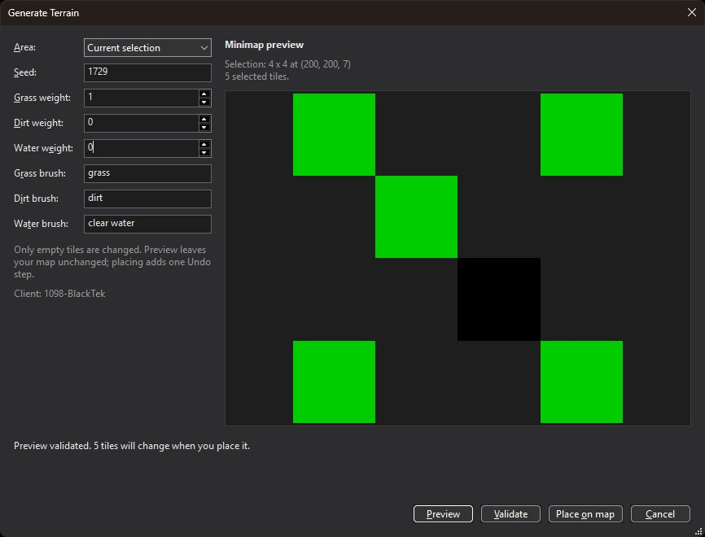
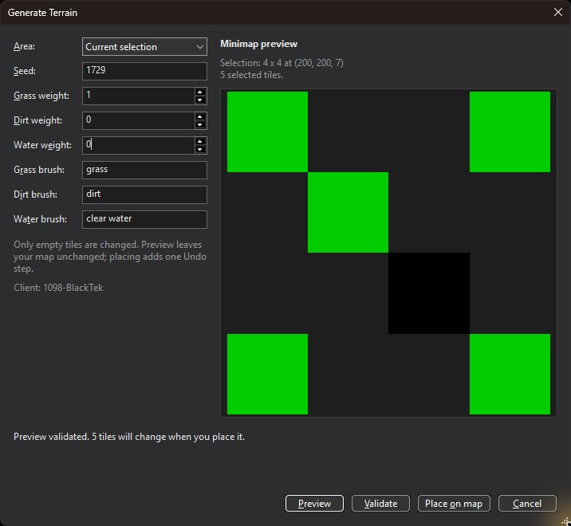

# G1 — Undo message and selection presentation

Update 2026-11-03: [next step — memory measurement and GUI blocking](G1_RESOURCES.md). Product code of this report kept unchanged; responsive cancellation still open.

2026-11-03: UX fix completed and verified in native Windows GUI. Full **G1 IN PROGRESS**; G2 not started. Codex performed this step **without new Claude run**.

## Effect

History refusal shows current memory/action limits, proposes smaller area or checking **File → Preferences → General**, then new Preview. Action acceptance rules and product limits unchanged.

In Current selection mode rectangle fields and their labels are hidden. Return to Empty rectangle preserves earlier values. Above minimap appears actual range captured by Preview, position and number of selected fields. After releasing preview description again asks to capture area.

Minimap uses `wxMemoryDC::SelectObjectAsSource` and `StretchBlit` with explicit destination rectangle. Margin not rounded to whole source pixels. GDI context has local lifetime; bitmap cached, no rescaled image created on paint. No changes to algorithm, history, or OTBM format. API checked via Context7 for wxWidgets 3.3.

Original JPEG from computer-use, no processing. Centering, description, controls, and buttons evaluated at 866×660 and 716×660. Green fields and black empty tile are minimap data, not sprite preview.

## Results and proof limits

| Run in `local-data/procedural-smoke/` | Result and scope |
|---|---|
| `g1-dialog-polish-rme-20261103` | **FAIL / exit 8**: test required phrase without line break. Kept; not passed. |
| `g1-dialog-polish-retry-rme-20261103` | **PASS_G1_NATIVE_DIALOG_UX_MATRIX_ONLY / exit 0**: 500×500, five fields with holes, input/old membership refusals, history limit 40 MiB, retry at 512 MiB, and both Place/Undo/Redo cycles. Centering still not passed visual evaluation. |
| `g1-dialog-centering-rme-20261103` | **PASS_G1_NATIVE_DIALOG_SELECTION_UX_ONLY / exit 0**: final drawing, description and hidden fields, resize, old membership refusal, Preview/Validate/Place/Undo/Redo of five fields. **This is selection-only test, not full matrix.** |

First failure concerned wrapped text comparison; observer now normalizes line breaks and records raw message. Second run confirmed `MATRIX_HISTORY_GUIDANCE_PASS` and `MATRIX_HISTORY_RETRY_PASS`. Limit 40→512 changed via real GUI only in private instance, keeping 400 actions. Curated profile sources kept hashes.

First centering fix via scaling and device origin insufficient on Windows. After this observation only drawing method changed; final selection-only test checked this version. **500×500 and 40 MiB refusal not re-run on final EXE**. Proof of their execution concerns earlier EXE below. Both PASS runs had normal shutdown, empty runtime stderr, and unchanged input assets.

Observer independently compares whole tile context against prepared result, history, revision, and protected sentinel outside area. For selection checks holes, exact membership without adding selected flags, and original tile identity after Undo. Fixture and membership change are programmatic; GUI commands are real operator inputs. Test does not cover mouse gestures creating selection.

Canonical `build_ninja.bat`: **exit 0** after final change. Log: `g1-dialog-polish-canonical-20261103.log`. Independent verifier of final run checked **421 RME objects, 421 compile inputs (including PCH), observer module, UI sources, both EXE, and curated assets**. From earlier matrix GUI only product dialog CPP and its header changed. Core inputs remain consistent with historical proof; G0 and core fault injection not re-run. At probe link two earlier C4723 warnings in wxWidgets header `gdiimage.h:117–118` remain; vendor not changed.

| Binary | SHA256 |
|---|---|
| Final normal EXE | `163537e3314739b40d5b305320149ba75a4170a317dc940b6bdc26a2a1231e32` |
| Final probe selection-only | `b39b9994f9fa5caed7241fbe45d7b9c8bbe7a203bb3d2db33719616c0a92ce2e` |
| Normal EXE of matrix before final paint fix | `a40cd2e339c4f63e919d403bafc3efc1a28b08c3b67963e9e94df64569a65c6d` |
| Probe of that matrix | `b415eae4093db0e2c5da5558863e73a84488c848e6ebcc336ef850ab2d31d660` |

## Reproduction and next step

`g1_run_dialog_probe.py OUTPUT PROFILE_DATA CONFIG --selection-only` runs only five-field fixture. In GUI: Current selection, seed 1729, weights 1/0/0, Preview → Validate → after `MATRIX_STALE_MEMBERSHIP_INJECTED` Place (refusal) → Preview → Validate → resize → Place → Undo → Redo. Verification: `g1_verify_dialog_probe.py OUTPUT --selection-only`. Run commands via `rtk proxy` and Python pointed to in [previous scenario](G1_DIALOG_MATRIX.md). `--matrix` still requires full matrix, now also both history and selection-presentation markers.

Next three tasks: (1) responsive cancellation/schedule and RSS, (2) remaining GUI refusals/faults: live, busy, no client, multi-floor selection, and allocations, (3) final generator GUI save/reopen OTBM with all companions and G1 matrix. Other DPI/platforms, sprite preview, result coexistence, nor full round-trip verified. Partial coverage not recognized as full G1.

Shared uncommitted changes kept; no commit/push. User maps and forbidden map/companions not opened; Docker, database, and user world not touched.
