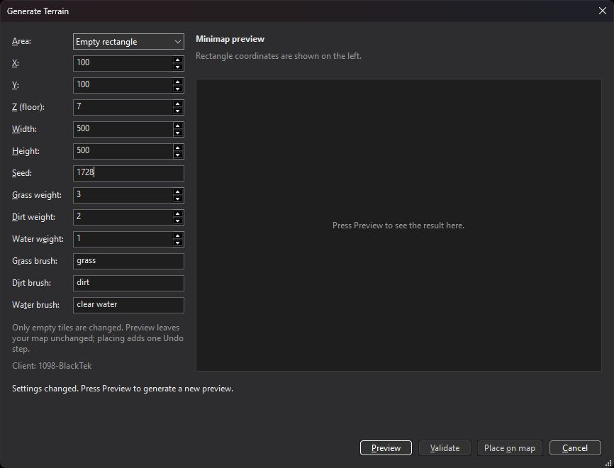

# G1 — Changing inputs and closing an active Preview

2026-11-04. **PARTIAL_G1_GUI_PREVIEW_INVALIDATION_FOCUS_WARNING**. Both scenarios and retries behaved as expected. RME exited with code 0. Stderr contained one wxWidgets `SetFocus` warning with code `0x00000057`. The run opened neither a map file nor the creature import prompt, so neither is required to reproduce the warning.

The private RME observer checks two ways to discard a 500×500 Preview task. It detects native seed-edit and window-close events before the handlers run and requires the “Preparing preview” state at that point. The operator enters the commands. After each operation, the observer watches for any republication of the result for two seconds.

The synthetic map has one sentinel tile outside the generation area. Throughout the run, the observer compares its state, editor identity, map revision, dirty flag, and empty undo history. Retrying in the same window must show seed 1728. After closing the second dialog during Preview, the next dialog must show the default 100×100 area with seed 1729.

The first seed edit in this process lacked confirmation of the “Preparing preview” state and was excluded. The faster retry logged `INVALIDATION_EDIT_IN_FLIGHT`. Validate and Place remained disabled for the next two seconds, and retry displayed 250,000 changes for seed 1728. The next attempt logged `INVALIDATION_CLOSE_IN_FLIGHT` on Alt+F4 and closed the dialog. After two seconds, the new dialog showed its own 10,000-tile preview for seed 1729.



`build_ninja.bat` passed with the production binary unchanged. The verifier for `g1-invalidation-rme-20261104` confirmed the full marker sequence, 421 objects, 421 compilation inputs, and unchanged input assets. This result covers seed edits and Alt+F4 on one map. Other target invalidation cases, dense maps, and leak tests remain outside its scope. Overall status is **G1 IN PROGRESS**.

## Reproduction

```text
rtk proxy <PY> docs/procedural/smoke/g1_run_dialog_probe.py local-data/procedural-smoke/NEW_RUN local-data/procedural-smoke/g0-reference-profile-20261030/data local-data/procedural-smoke/g0-reference-profile-20261030/config.toml --invalidation
rtk proxy <PY> docs/procedural/smoke/g1_verify_dialog_probe.py local-data/procedural-smoke/NEW_RUN --invalidation
```

`<PY>` is `C:/Users/Sorky/.cache/codex-runtimes/codex-primary-runtime/dependencies/python/python.exe -X utf8`. After `INVALIDATION_FIXTURE_READY`, open Map → Generate terrain, set a 500×500 area, start Preview, and quickly change the seed from 1729 to 1728. After `INVALIDATION_EDIT_PASS`, run Preview again. After `INVALIDATION_EDIT_RETRY_PASS`, close and reopen the dialog. Set 500×500, start Preview, and close the window with Alt+F4 while it runs. After `INVALIDATION_CLOSE_PASS`, open a new dialog and run Preview with the defaults. Close the dialog, then close the private application after `INVALIDATION_PASS`.
