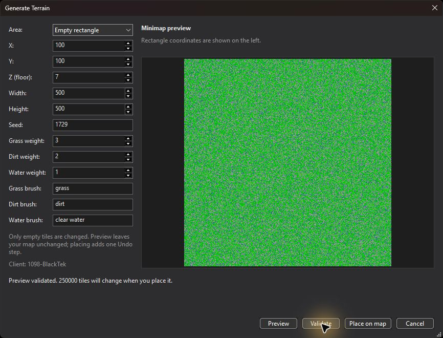

# G1 — powtarzalność Place → Undo → Redo → Save dla 500×500

2026-11-05. Dwa dodatkowe przebiegi natywnego RME uzupełniają [pierwszy pomiar](G1_ROUNDTRIP.md#pomiar-place-undo-redo-i-save-dla-500500). Każdy proces zakończył się kodem 0. Niezależny weryfikator `--roundtrip-timing` sprawdził cztery rekordy każdego przebiegu względem logu GUI i zwrócił **PARTIAL_G1_GUI_ROUNDTRIP_TIMING_FOCUS_WARNING**. Każdy stderr zawierał jedno znane ostrzeżenie `SetFocus` z kodem `0x00000057`.

## Zakresy z trzech prób

| Operacja | Od zdarzenia do obserwacji [ms] | Maks. odstęp timera GUI [ms] | Szczyt working set [MiB] | Przyrost working set [MiB] | Szczyt private commit [MiB] | Przyrost private commit [MiB] |
| --- | ---: | ---: | ---: | ---: | ---: | ---: |
| Place | 403,4–419,4 | 428,1–544,4 | 912,32–912,63 | 110,23–110,56 | 760,05–760,72 | 114,82–115,25 |
| Undo | 77,0–78,1 | 89,3–119,2 | 839,60–841,54 | 0,26–2,44 | 687,86–691,78 | 0,30–2,70 |
| Redo | 72,1–76,8 | 85,6–94,9 | 839,82–841,16 | 0,34–0,65 | 688,02–691,96 | 0,34–0,70 |
| Save | 188,0–190,0 | 198,4–213,3 | 839,41–841,30 | 0,04–0,04 | 687,02–691,50 | 0,03–0,10 |

Czas kończy się na pierwszym tyknięciu obserwatora 20 ms, które widzi zmianę historii lub flagi zapisu. Maksymalny odstęp timera jest osobną miarą, ponieważ może zacząć się przed poleceniem, np. podczas obsługi menu. Sampler pamięci żąda odstępu 5 ms. Największy zarejestrowany odstęp wyniósł 6,61 ms, więc krótsze szczyty mogą wypaść między próbkami. Przyrost oznacza różnicę między próbkowanym szczytem a bazą danej operacji. Obciążenie hosta i stan cache pierwszej próby nie zostały zarejestrowane.

## Build i warunki

`build_ninja.bat` zakończył się kodem 0 po dodaniu istniejącego Ninja do PATH sesji. Ninja zgłosił `no work to do`. SHA‑256 produkcyjnego EXE we wszystkich próbach to `15c25557d955a13831e665b27db793f4086478036fd52025a13cef490d592451`.

Manifesty mają identyczne hashe 421 wejść kompilacji i 421 obiektów produkcyjnych oraz identyczne hashe źródła próbnika, skryptów runnera i wejściowych assets wraz z konfiguracją profilu. Każda próba osobno skompilowała `input_probe.obj` i zlinkowała prywatny EXE. Porównanie bajtowe prywatnych EXE wykazało wyłącznie różnicę w dwóch zapisach tego samego znacznika czasu linkowania.

Każda próba użyła syntetycznego OTBM 5 z pięcioma kaflami fixture, prywatnego profilu 1098-BlackTek i limitu historii 512 MiB. Ustawienia generatora to pusty prostokąt 500×500 od (100, 100, 7), seed 1729, wagi 3/2/1 oraz pędzle grass, dirt i clear water. Po Preview i Validate użyto przycisku Place on map oraz poleceń Edit → Undo, Edit → Redo i File → Save. Instrukcja odtworzenia jest w [raporcie round-trip](G1_ROUNDTRIP.md#pomiar-place-undo-redo-i-save-dla-500500).

## Dowody i zakres weryfikacji

| Katalog w `local-data/procedural-smoke/` | SHA‑256 surowego CSV | SHA‑256 prywatnego EXE |
| --- | --- | --- |
| `g1-place-timing-20261105` | `cf1e3db8a72893a9d11c481f3288b530fb5e91404527afb83dcca8671dca8e17` | `f1c30a1db3c1e508da0cf47d2c04c3041a4632ad225d9ee907d0fdc1d1427e22` |
| `g1-place-timing-repeat-2-20261105` | `6cf0555766c0317901ca5f7bb40e4ce1890ebaa7b3d4f35f337c611ff36f6c1e` | `9a088da7639260ecc6771901f35c5cc82ee3dd84a2e9693a54a7851b2f98038d` |
| `g1-place-timing-repeat-3-20261105` | `8c5eed709dc31ca8abb98c13e34ca53bcab15c8e25b1eeca7572a1ddc8b4d2ce` | `0bb25f3ce7aae1864d59c9404e6f1e2923c9cd5fc0f7a842b929148801435332` |

Każdy katalog zawiera `current-verification.json` i `run/roundtrip-timing.csv`. [Zbiorczy CSV](benchmarks/g1-place-timing-repeatability-20261105.csv) zawiera wszystkie 12 wierszy z identyfikatorami prób i pamięcią w bajtach. SHA‑256 zbiorczego CSV to `de481061ee3efeaff7e33f63383909f857da222474d12a8cf16c868be8a344bb`.

Tryb pomiaru sprawdza historię, liczbę kafli i pięć kafli fixture. Save obserwuje wyczyszczenie flagi zmian i obecność pliku, który istnieje już po zapisie bazowym. Dlatego poza pomiarem porównano SHA‑256 zapisanych syntetycznych OTBM z zachowanym wynikiem pełnej próby `g1-roundtrip-500-post-preflight-rme-20261104`. Wszystkie cztery pliki mają SHA‑256 `b02588b46490c486b4eacc94cff1c41d5da8e805f51aec47b136774b004f5d56`. W trzeciej próbie hash przed Place wynosił `d1fa55bffb9a422e0a5e4109d1fef15f5052287a289fa8a6293925d1ce616671`.

Porównanie plików po zapisie potwierdziło także identyczne rozmiary i SHA‑256 wszystkich pięciu niepustych companionów XML w trzech próbach czasowych i w zachowanym pełnym round-tripie 500×500. Porównano pliki domu, potworów, NPC, waypointów i stref. Dowód ponownego otwarcia pochodzi z wcześniejszych prób OTBM 5. Diagnoza `SetFocus` jest odłożona. **G1 IN PROGRESS**. Ocena bramki zasobów wymaga uzgodnionych progów.
