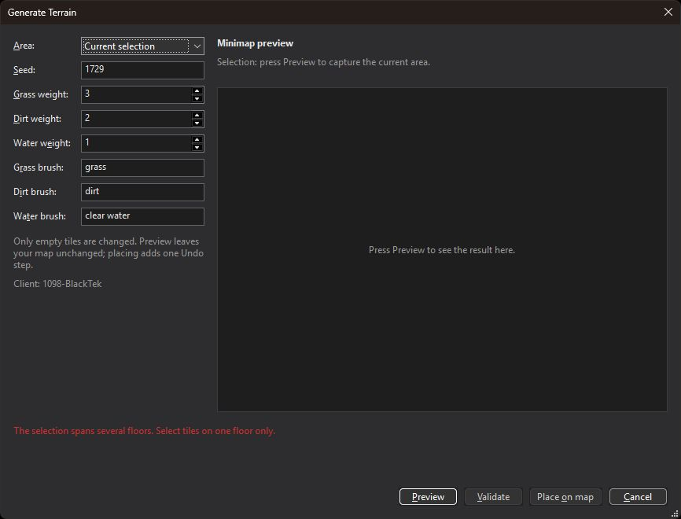

# G1 — odmowy przygotowania Preview

2026-11-04. **PARTIAL_G1_GUI_PREVIEW_REFUSALS_FOCUS_WARNING**. Wszystkie przypadki funkcjonalne przeszły. Proces zakończył się z kodem 0, lecz stderr zawierał pojedynczy komunikat wxWidgets `SetFocus` z kodem `0x00000057`. Nie ustalono, który etap go wywołał.

Test natywnego dialogu na syntetycznej mapie z prywatnym profilem 1098-BlackTek. Każdy Preview uruchamia operator. Obserwator przełącza wyłącznie stan fixture w tej instancji RME.

| Próba | Stan testowy | Sprawdzany komunikat |
|---|---|---|
| 1 | Current selection zawiera po jednym polu na piętrach 7 i 8 | The selection spans several floors |
| 2 | Empty rectangle przy otwartej wewnętrznej sesji zaznaczenia | Finish the current selection or edit first |
| 3 | Empty rectangle w trybie live na nieuruchomionym hoście | Terrain generation is not available during a live session |
| 4 | Jednorazowy błąd alokacji wektora halo dla prostokąta 100×100 | Not enough memory for this preview |
| 5 | Rozładowany klient dla tego samego edytora | No client is loaded |
| 6 | Ponownie załadowany klient i domyślny prostokąt | Preview ready dla 10 000 pól |

Obserwator sprawdza zawartość obu pól, rozmiar zaznaczenia, rewizję, brak flagi dirty i pustą historię. Po każdej odmowie wymaga wyłączonych Validate i Place. Testowy host otrzymuje obiekt i kolejkę trybu live bez nasłuchiwania, łączenia ani synchronizacji. Błąd alokacji jest wstrzykiwany wyłącznie w binarium obserwatora na wątku GUI.



## Dowody i zakres

`g1-refusals-aligned-rme-20261104` zawiera sześć markerów `REFUSAL_CASE_PASS` w kolejności i końcowy `REFUSAL_PASS`. Wejściowe assets i źródła zachowały hashe. Verifier potwierdził 421 obiektów i 421 wejść kompilacji oraz oba EXE. Runner zachował wynik negatywny dla kryterium pustego stderr. Verifier jawnie oznaczył udokumentowaną próbę jako częściową.

Kanoniczny `build_ninja.bat` przeszedł. Ninja zgłosił `no work to do`, a SHA-256 produkcyjnego EXE jest identyczne z przebiegiem anulowania. Pierwszy build obserwatora odrzucił błędną sygnaturę `createTile`. Kolejny build odrzucono po zmianie źródła podczas linkowania, gdy dopasowano rozmiar alokacji do narzutu wektora MSVC. Oba przebiegi zachowano bez zaliczenia.

Zakres obejmuje odmowy Preview i powrót do gotowego podglądu. Osobno pozostają rzeczywiste sesje sieciowe, inne miejsca awarii alokacji, ponowny test Place/Undo/Redo oraz generatorowy zapis i ponowne otwarcie OTBM z companionami. Pełne **G1 IN PROGRESS**.

## Odtworzenie

```text
rtk proxy <PY> docs/procedural/smoke/g1_run_dialog_probe.py local-data/procedural-smoke/NEW_RUN local-data/procedural-smoke/g0-reference-profile-20261030/data local-data/procedural-smoke/g0-reference-profile-20261030/config.toml --refusals
rtk proxy <PY> docs/procedural/smoke/g1_verify_dialog_probe.py local-data/procedural-smoke/NEW_RUN --refusals
```

`<PY>` to `C:/Users/Sorky/.cache/codex-runtimes/codex-primary-runtime/dependencies/python/python.exe -X utf8`. Nie klikaj w obszar mapy (kończy to próbnik błędem `Source changed`). Otwórz Map → Generate terrain i wybierz Current selection. Naciśnij Preview, poczekaj na `REFUSAL_CASE_PASS` dla przypadku 0, następnie wróć do Empty rectangle. Uruchom pięć kolejnych Preview w tym samym dialogu, za każdym razem czekając na marker kolejnego przypadku. Po gotowym podglądzie zamknij dialog przez Cancel.

## Powtórzenie na drzewie z 2026-11-06

Przebieg `NEW_RUN_REFUSALS_2` na obecnym drzewie dał sześć markerów `REFUSAL_CASE_PASS` w kolejności 0–5 i końcowy `REFUSAL_PASS`, exit 0. Verifier zwrócił `PARTIAL_G1_GUI_PREVIEW_REFUSALS_FOCUS_WARNING`: te same 421 obiektów i 421 źródeł, a na stderr jedyny komunikat wxWidgets `SetFocus` z kodem `0x00000057`. Runner zachował `passed: false` przez niepusty stderr, tak jak w przebiegu z 2026-11-04.

Wcześniejsze dwa przebiegi z tego dnia padły z `FAILED Source changed: map generation`, bo operator kliknął w obszar mapy. Obserwator wymaga niezmienionej generacji mapy i kończy proces przez `_Exit(8)` bez komunikatu w oknie. Zmiany generacji po kliknięciu nie sprawdzono w kodzie, wniosek opiera się na zgodności z logiem (dwa oznaczone chunki, dwa kafle fixture) i na tym, że przebieg bez klikania w mapę przeszedł. Komunikat błędu obserwatora podaje teraz generację początkową i bieżącą oraz fazę. Operator klika wyłącznie menu i dialog.
