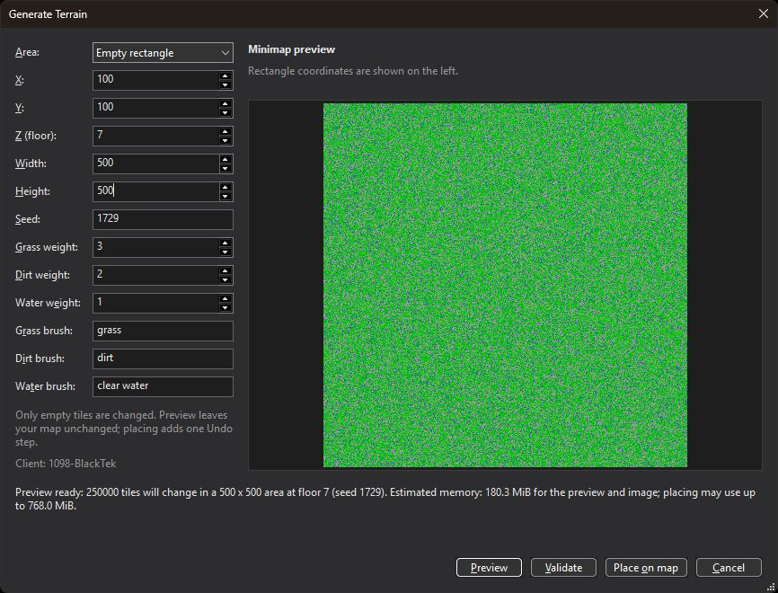

# G1 — process memory measurement and GUI blocking

2026-11-03: **PASS_G1_GUI_RESOURCE_BASELINE_ONLY**. Baseline measurement complete; full **G1 IN PROGRESS**. **Responsive cancellation during generation not implemented or passed.** G2 not started. Codex performed step without new Claude run.

## Goal and result

Measured real Preview/Validate/Cancel in native RME: three 100×100 cycles and three 500×500, without second large comparison result in observer. Synthetic map contained one protected sentinel outside area, generation position (100,100,7), seed 1729, weights 3/2/1, and grass/dirt/clear water brushes, curated client 1098-BlackTek.

Preview 500×500 reached observation of ready result in **523.5–528.4 ms**, with GUI timer breaks **536.5–546.1 ms**. Measured process working set in these windows reached **805.6 MiB**, increment relative to state immediately before Preview was **79.3–80.5 MiB**. UI still blocks for preparation time. This is baseline for schedule change, without performance improvement claim.



## Data

All memory values in table are **MiB = 1,048,576 bytes**. "After Cancel" comes from end of additional observation window lasting at least a second after dialog close. First cycle of each size includes warmup of its allocation path; not removed from statistics.

| Cycle | Size | Preview to observation READY [ms] | Max GUI break [ms] | WS before Preview | Peak WS | WS increment | WS after Cancel |
|---|---|---:|---:|---:|---:|---:|---:|
| 1 | 100×100 | 64.6 | 103.4 | 719.0 | 722.4 | 3.5 | 721.9 |
| 2 | 100×100 | 66.0 | 101.8 | 722.5 | 723.1 | 0.5 | 722.5 |
| 3 | 100×100 | 67.1 | 93.9 | 723.4 | 723.4 | 0.0 | 722.9 |
| 4 | 500×500 | 528.4 | 541.9 | 724.2 | 804.6 | 80.5 | 724.5 |
| 5 | 500×500 | 523.5 | 536.5 | 726.0 | 805.4 | 79.4 | 724.9 |
| 6 | 500×500 | 524.4 | 546.1 | 726.2 | 805.6 | 79.3 | 728.8 |

Validate took 24.0–27.0 ms for 100×100 and 92.0–96.7 ms for 500×500. Observation of closed dialog after Cancel: respectively 41.0–49.3 ms and 107.7–119.4 ms. These times include reaching next timer read, not exact handler CPU time.

Private commit process peaks for 500×500 Preview reached **647.6 / 649.2 / 649.4 MiB**, increments **83.2 / 81.2 / 81.4 MiB**. After Cancel and second observation: **567.4 / 567.7 / 572.3 MiB**. Working set after large cycles: **724.5 / 724.9 / 728.8 MiB**. Last cycle left a few MiB more; three repeats and process counters do not resolve whether cache/allocator or retention requiring further analysis accounts for it. **Leak-absence test not passed.**

Baseline working set contains assets, renderer, and rest of RME. Visible in UI **7.7 / 180.3 MiB** are estimates of preparation and image, and **512 MiB** is budget for this estimate, not entire process RSS limit. Smaller measured WS increment does not prove estimator correctness for all maps or absence of short peaks.

[Full raw CSV: 24 records, including private memory and sample intervals](benchmarks/g1-ui-resources-20261103.csv). SHA256: `56564d3bb5a2d85b0c46471809c2833a0e47d4646089aa70a4472cbed1286cf4`.

## Method and safeguards

`tests/test_procedural_dialog_resources.cpp` is private module of normal application entry. Operator executes commands only via native GUI. `wxEventFilter` watches command start and always returns `Event_Skip`; 20 ms GUI timer detects result, validation, and close. Maximum timer break may include fragment of interval before command, rendering, and system load. Not exact measure of specific Cancel click latency.

Separate `std::jthread` reads only own process counters, no GUI, Tile, map, or manager access. Requested sample interval 5 ms; largest measured interval in entire run was **6.8 ms**. Shorter peaks may have been missed. Join precedes state sampler destruction.

Working set means current resident process pages; private commit is separate counter. Meaning and call checked in [Microsoft PROCESS_MEMORY_COUNTERS_EX](https://learn.microsoft.com/en-us/windows/win32/api/psapi/ns-psapi-process_memory_counters_ex) and [GetProcessMemoryInfo](https://learn.microsoft.com/en-us/windows/win32/api/psapi/nf-psapi-getprocessmemoryinfo). Context7 confirmed wxWidgets 3.3 filter contract; found no suitable PSAPI documentation, used official Microsoft Learn.

Map state checked during each GUI read: same identity and revision, exactly one unchanged sentinel, empty history and no dirty. All six Cancels kept this state. **Cancel executed only after ready Preview and Validate.** Not sent from observer and not simulated quick cancellation during work.

Hardware: Intel Core i7-11850H, 16 logical processors, 34,069,032,960 bytes total physical memory reported by system (about 31.7 GiB); Windows AMD64, build `10.0.26300`. MSVC/Ninja **Release** build. System settings or other apps load not changed. Instrumentation and computer-use also have cost; this baseline measurement of this environment, not lab result or comparative benchmark.

## Verification

Canonical `build_ninja.bat`: **exit 0**, log `local-data/procedural-smoke/g1-resources-canonical-20261103.log`. Product CPP and normal EXE unchanged from accepted UX step. New code is observer and runner/verifier `--resources` option. Previous failed module build (`g1-resources-rme-20261103`) kept: PSAPI name error on header config; did not run test and not passed. Fix uses `GetProcessMemoryInfo` and system Psapi library.

`g1-resources-final-rme-20261103`: **PASS / exit 0 / normal shutdown / empty stderr / assets and source inputs unchanged**. Independent verifier checked 421 RME objects, 421 compile inputs (including PCH), observer, both EXE, curated assets, CSV hash, and all 24 records in expected order. At probe link two earlier C4723 warnings in wxWidgets header `gdiimage.h:117–118` remain; vendor not changed. Older G0 audits and core not re-run.

Normal EXE SHA256: `163537e3314739b40d5b305320149ba75a4170a317dc940b6bdc26a2a1231e32`.

Probe SHA256: `930e0e9c463309d3c42ed01b1af058d48aeada2ed14347cb84703912d8968a6b`.

Second [original 100×100 screen](screenshots/g1-resources-100-20261103.jpg). Both JPEG from native computer-use, no edits. Show minimap, not sprite renderer. Private process exited normally.

## Reproduction and next point

```text
rtk proxy <PY> docs/procedural/smoke/g1_run_dialog_probe.py local-data/procedural-smoke/NEW_RUN local-data/procedural-smoke/g0-reference-profile-20261030/data local-data/procedural-smoke/g0-reference-profile-20261030/config.toml --resources
rtk proxy <PY> docs/procedural/smoke/g1_verify_dialog_probe.py local-data/procedural-smoke/NEW_RUN --resources
```

`<PY>` = `C:/Users/Sorky/.cache/codex-runtimes/codex-primary-runtime/dependencies/python/python.exe -X utf8`. After `RESOURCE_CASE_READY` open Map → Generate terrain. Cycles 1–3: 100×100; 4–6: 500×500. Each time Preview → after READY marker Validate → after VALIDATE_PASS marker Cancel → wait for next CASE_READY. Do not close process between cycles. Runner does not click itself. Timeout leaves same private process for inspection.

Next implementation step: staged preparation with cancellation and task ID. Snapshot/client/resolver/DrawOperations must keep confirmed thread rules; worker can receive only own data. Current `prepareTerrain` should not move wholesale to worker: controls GUI thread and uses managers and live map. Must also measure final Validate time and result release, and reject deferred result after Cancel or target change before publication.

Remaining next tasks: GUI refusals/faults and final generator save/reopen OTBM with all companions. This run did not check Commit/Undo, commit RSS, dense maps, parallel work, multi-floor, other DPI/platforms, leak detector, or full G1 matrix. Shared uncommitted changes kept, no commit/push, and no new Claude. User maps and forbidden map/companions not opened; Docker, database, and user world not touched.
