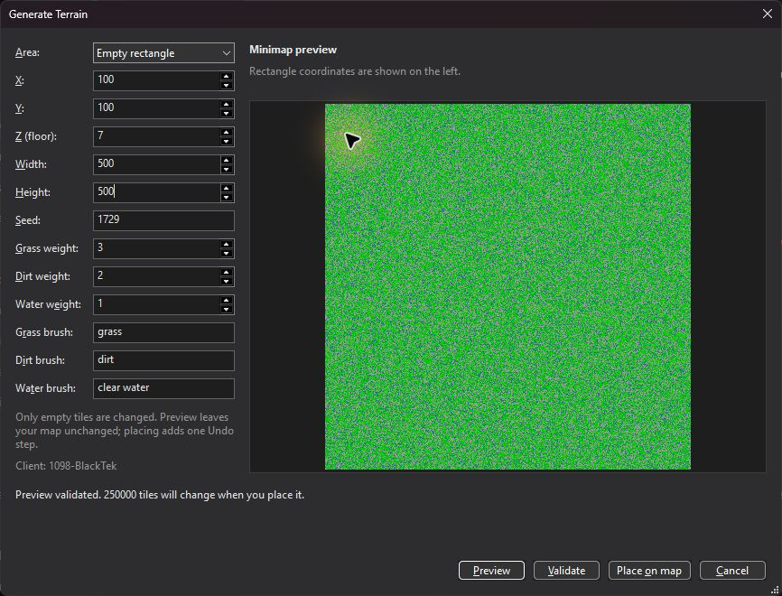
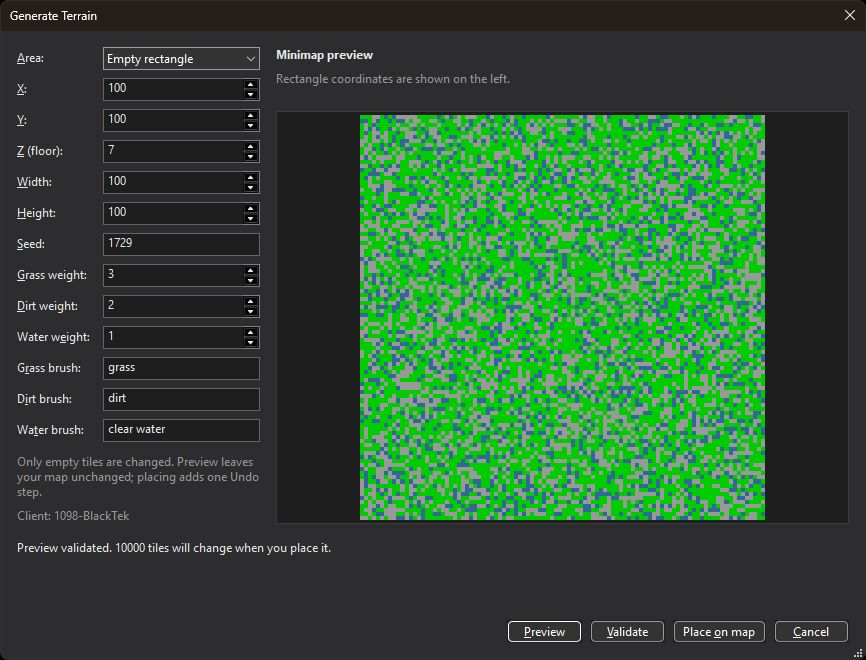

# G1 — zapis i ponowne otwarcie wygenerowanego OTBM

## Pomiar Place, Undo, Redo i Save dla 100×100

2026-11-05. Claude Code rozszerzył runner, próbnik C++ i niezależny weryfikator w osobnym worktree przez lokalny bridge (`3f91cfcc-b008-48a0-a480-0591f5da7ec4`). Po przeglądzie zintegrowano trzy pliki harnessu. `build_ninja.bat` przeszedł. SHA‑256 produkcyjnego EXE to `15c25557d955a13831e665b27db793f4086478036fd52025a13cef490d592451`.

W przebiegu `g1-place-timing-100-20261105` użyto syntetycznego OTBM 5, prywatnego profilu 1098-BlackTek i limitu historii 512 MiB. Prostokąt zaczynał się w (100, 100, 7). Użyto seeda 1729 i wag 3/2/1. Po Preview i Validate wykonano Place przyciskiem dialogu oraz Undo, Redo i Save z menu. Proces zakończył się kodem 0. Weryfikator w trybie domyślnym potwierdził cztery pomiary, źródła, obiekty i binaria. Wynik **PARTIAL_G1_GUI_ROUNDTRIP_TIMING_FOCUS_WARNING** zachowuje jedno znane ostrzeżenie `SetFocus`.

| Operacja | Od zdarzenia do obserwacji [ms] | Maks. odstęp timera GUI [ms] | Szczyt working set [MiB] | Przyrost working set [MiB] | Szczyt private commit [MiB] | Przyrost private commit [MiB] |
| --- | ---: | ---: | ---: | ---: | ---: | ---: |
| Place | 84,34 | 113,71 | 728,59 | 6,09 | 570,59 | 7,34 |
| Undo | 48,39 | 88,29 | 728,91 | 0,26 | 570,86 | 0,25 |
| Redo | 41,64 | 65,30 | 729,22 | 0,63 | 571,14 | 0,69 |
| Save | 123,95 | 147,23 | 728,55 | 0,02 | 570,29 | <0,01 |

Odstęp timera GUI może zacząć się przed poleceniem. Obserwator ma okres 20 ms, a największy odstęp próbkowania pamięci wyniósł 6,46 ms. Wyniki opisują jedną próbę. Pomiary zasobów Preview i Validate dla 100×100 na tym EXE pozostają otwarte.

OTBM i pięć companionów zapisanych przez próbnik są identyczne bajtowo z zachowanym pełnym round-tripem 100×100. Ponowne otwarcie pokrywa wcześniejszy przebieg. [Surowy CSV](benchmarks/g1-place-timing-100-20261105.csv) ma SHA‑256 `6a5b2dab9f66358d7f1065fa0f6a41d362270534016233a1765df89b054bc447`. [Zrzut po Validate](screenshots/g1-place-timing-100-20261105.jpg).

Aby odtworzyć, użyj [polecenia runnera](#odtworzenie) z `--roundtrip-side 100 --roundtrip-timing`, a w weryfikatorze wybierz `--roundtrip-timing`. Trzy historyczne przebiegi czasowe 500×500 ponownie zweryfikowano z dodatkowym `--archived-harness-root local-data/procedural-smoke/g1-timing-500-harness-20261105`. Ta opcja wymaga dokładnych hashy dawnego runnera i próbnika. Pozostałe hashe są sprawdzane względem aktualnego checkoutu i buildu. Próby negatywne odrzuciły zmienione źródło archiwalne, błędny marker rozmiaru i niezgodny bok w CSV mimo ponownie przeliczonego hasha pliku.

## Pomiar Place, Undo, Redo i Save dla 500×500

2026-11-05, jeden przebieg `g1-place-timing-20261105`. Kanoniczny `build_ninja.bat` zakończył się kodem 0, EXE `15c25557…`. Prywatny próbnik RME użył syntetycznego OTBM 5, profilu 1098-BlackTek i limitu historii 512 MiB. Runner potwierdził cztery wiersze w kolejności, aktualność źródeł i niezmienione assets. Kod wyjścia 0, jedno znane ostrzeżenie `SetFocus`, status **PARTIAL_G1_GUI_TIMING_FOCUS_WARNING**.

| Operacja | Czas do obserwacji [ms] | Maks. odstęp timera GUI [ms] | Szczyt WS [MiB] | Przyrost WS [MiB] | Szczyt private commit [MiB] | Przyrost private commit [MiB] |
| --- | ---: | ---: | ---: | ---: | ---: | ---: |
| Place | 413,8 | 544,4 | 912,32 | 110,23 | 760,05 | 114,82 |
| Undo | 77,0 | 119,2 | 839,60 | 2,44 | 691,78 | 2,70 |
| Redo | 72,1 | 94,9 | 839,82 | 0,34 | 691,96 | 0,34 |
| Save | 189,6 | 213,3 | 839,41 | 0,04 | 691,50 | 0,10 |

Czas zaczyna się na zdarzeniu przycisku Place lub polecenia menu i kończy na pierwszym ticku timera 20 ms, który widzi zmianę historii lub flagi zapisu. Odstęp timera może zacząć się przed poleceniem, np. podczas obsługi otwartego menu. Dlatego odstęp 544,4 ms nie jest czasem handlera Place. Sampler pamięci działa z żądanym odstępem 5 ms, a największy zaobserwowany odstęp próbkowania wyniósł 6,53 ms. Szczyty są wartościami zaobserwowanymi. Przyrost każdej operacji odnosi się do jej własnego stanu początkowego.

Ten tryb pomija niezależny podgląd i pełny skan kafli. Po operacji sprawdza historię, liczbę kafli i pięć kafli fixture. Pełne porównanie payloadu oraz ponowne otwarcie są w oddzielnych przebiegach poniżej. Jeden przebieg daje pomiar w tym środowisku. Ocena powtarzalności i przyjęcie progów zasobów pozostają otwarte.

Aby odtworzyć próbę, użyj polecenia runnera z sekcji odtworzenia z dodatkowym `--roundtrip-side 500 --roundtrip-timing` i świeżym katalogiem. Po `ROUNDTRIP_FIXTURE_READY` ustaw Width i Height na 500. Wykonaj Preview, Validate i Place on map, potem z menu Edit wybierz Undo, następnie Redo, a z menu File wybierz Save. Poczekaj na marker po każdym kroku. Po `ROUNDTRIP_TIMING_PASS` zamknij prywatną aplikację. Surowe dane są w `local-data/procedural-smoke/g1-place-timing-20261105/run/roundtrip-timing.csv`, wynik runnera w `verification.json` obok katalogu `run`.


Po przebiegu uruchom `g1_verify_dialog_probe.py OUTPUT --roundtrip-timing`. Weryfikator porównuje hashe źródeł, obiektów i EXE, sprawdza CSV oraz zgodność jego czterech wierszy z logiem GUI. Zapisany przebieg dał **PARTIAL_G1_GUI_ROUNDTRIP_TIMING_FOCUS_WARNING** w `current-verification.json`. Na kopiach danych weryfikator odrzucił błędny hash CSV, rozbieżny czas, błędny szczyt pamięci, nieskończony odstęp oraz ułamkową liczbę próbek.

## Powtórzenie 100×100 na aktualnym buildzie

Przebieg `g1-roundtrip-100-post-preflight-rme-20261104` na tym samym buildzie produkcyjnym `15c25557…` co ostatnie 500×500 potwierdził natywne Preview → Validate → Place → Undo → Redo → Save → Close → Open. Place utworzyło jeden wpis historii. RME ponownie odczytał 10 005 kafli. Obserwator potwierdził zgodność wszystkich 10 000 wygenerowanych kafli i zachowanie pięciu kafli fixture. OTBM i wszystkie pięć XML mają identyczne hashe jak poprzedni przebieg 100×100.

Verifier sprawdził 421 obiektów, 421 wejść kompilacji i niezmienione assets. Kod wyjścia 0, jedno odłożone ostrzeżenie `SetFocus`, status **PARTIAL_G1_GUI_OTBM5_ROUNDTRIP_FOCUS_WARNING**. Oba rozmiary mają teraz aktualny dowód round-trip OTBM 5 w RME. Ten przebieg nie mierzył pamięci ani responsywności.

## Powtórzenie 500×500 po poprawce kontroli wstępnej

2026-11-04. `g1-roundtrip-500-post-preflight-rme-20261104` powtórzył pełną sekwencję na aktualnym buildzie `15c25557…`. Natywne Place zajęło jeden wpis historii. Undo i Redo przeszły, a odczyt przywrócił wszystkie 250 000 wygenerowanych kafli i pięć kafli fixture. Verifier potwierdził 421 obiektów, 421 wejść kompilacji i niezmienione assets. Zapisany OTBM i pięć XML mają identyczne hashe jak poprzednia próba 500×500.

RME wyświetlił odczytany teren w rendererze i na minimapie po Go To Position do `(350, 350, 7)`. Proces zakończył się kodem 0 z jednym odłożonym ostrzeżeniem `SetFocus`, więc raport zachowuje status **PARTIAL_G1_GUI_OTBM5_ROUNDTRIP_FOCUS_WARNING**. Przebieg obejmuje 500×500, OTBM 5 i odczyt w RME.


## Pełna ścieżka 500×500

2026-11-04. W przebiegu `g1-roundtrip-500-rme-20261104` operator wykonał Preview → Validate → Place → Undo → Redo → Save → Close → Open. Place zajęło jeden wpis historii. Obserwator sprawdził zgodność zawartości wszystkich 250 000 wygenerowanych kafli po Place, Redo, zapisie i odczycie, a po Undo potwierdził powrót do pięciu kafli fixture. Ponownie otwarta mapa była czysta i miała pustą historię.

Niezależny verifier potwierdził 250 005 kafli, brak zapisów poza prostokątem i fixture, identyczne binarne węzły pięciu kafli fixture oraz zgodność pięciu niepustych plików XML. Wejściowe assets zachowały hashe. Proces zwrócił 0. Dwa ostrzeżenia `SetFocus` zachowano w stderr. Verifier wymaga pełnej sekwencji zdarzeń i zgodności danych również przy tych ostrzeżeniach, a wynik wykonania oznacza jako **PARTIAL_G1_GUI_OTBM5_ROUNDTRIP_FOCUS_WARNING**.

Limit historii 512 MiB dotyczył wyłącznie prywatnego profilu. Przebieg przechowywał drugi podgląd do porównań, więc pomiar pamięci i przerw GUI pozostaje w [odrębnym raporcie Preview](G1_CANCEL.md). Weryfikacja binariów i plików jest w `local-data/procedural-smoke/g1-roundtrip-500-rme-20261104/current-verification.json`.



## Powtórzenie po rozdzieleniu odczytu i zamknięcia RME

Przebieg `g1-roundtrip-post-modal-rme-20261104` powtórzył pełną sekwencję z tym samym fixture. Obserwator czekał, aż główne okno znów będzie aktywne, i pozostawił otwartą mapę do ręcznej inspekcji. Gdy okno „Missing creatures” było jeszcze widoczne, log obserwatora kończył się na `ROUNDTRIP_CLOSED`, a stderr już zawierał ostrzeżenie `SetFocus`. Zamknięcie procesu przez obserwator nie było więc warunkiem wystąpienia ostrzeżenia. Dokładnego wywołania nie ustalono.

Po odrzuceniu importu RME zgłosił `Map loaded: terrain.otbm (10005 tiles)`. Obserwator potwierdził zawartość wszystkich 10 000 wygenerowanych kafli i metadane fixture. Ręczne Go To Position do `(150, 150, 7)` pokazało teren w rendererze sprite’ów i na minimapie. Po ręcznym zamknięciu proces zwrócił 0. Verifier potwierdził te same hashe zapisanego OTBM i wszystkich pięciu XML co w pierwszym przebiegu oraz 421 aktualnych obiektów i 421 wejść kompilacji. Status pozostaje **PARTIAL_G1_GUI_OTBM5_ROUNDTRIP_FOCUS_WARNING**.


## Pierwszy przebieg

2026-11-04. **PARTIAL_G1_GUI_OTBM5_ROUNDTRIP_FOCUS_WARNING**. Place → Undo → Redo → Save → Close → Open i porównania danych przeszły. Proces zakończył się z kodem 0, a stderr zawierał jedno ostrzeżenie wxWidgets `SetFocus` z kodem `0x00000057`. Przyczyny ostrzeżenia nie ustalono.

## Zakres

Prywatny profil 1098-BlackTek i syntetyczna mapa OTBM 5. Przed generacją obserwator zapisuje osobną kopię odniesienia z pięcioma kaflami fixture poza obszarem generacji. Mapa zawiera dom z wyjściem, UID, AID i tekstem na przedmiocie, osobne spawny potwora i NPC, waypoint w trybie BOTH oraz strefę na piętrze 8.

Operator uruchamia w natywnym GUI Preview i Validate domyślnego prostokąta 100×100 z seedem 1729. Następnie wykonuje Place, Undo, Redo, Save, Close i Open. Obserwator porównuje konkretny payload 10 000 kafli z niezależnie przygotowanym podglądem i sprawdza jeden krok historii. Ponowne otwarcie ma utworzyć nową instancję mapy z pustą historią i zachowanymi danymi fixture.

Niezależny verifier parsuje oba OTBM i pięć par XML. Porównuje nagłówki, binarne metadane, położenia kafli, pełne węzły fixture oraz dane XML. Porównanie ignoruje formatowanie XML i kolejność atrybutów. Zakres obejmuje ponowne otwarcie przez RME.



## Wynik

- Place zapisało jeden krok historii. Undo usunęło wszystkie 10 000 wygenerowanych kafli, a Redo odtworzyło ich zawartość. Po zapisie i ponownym otwarciu obserwator porównał zawartość wszystkich tych kafli, sprawdził dane fixture i pustą historię.
- Niezależny odczyt dysku potwierdził 10 005 kafli po zapisie, identyczne węzły pięciu kafli fixture, zachowane binarne dane waypointu i strefy oraz zgodne, niepuste XML domu, potworów, NPC, waypointów i stref.
- RME podczas otwarcia zaproponowało import brakującej definicji kreatury. Odrzucono import. Obserwator sprawdził załadowane dane mapy i spawny, lecz przebieg nie oceniał renderowania kreatury ani widoku mapy po zamknięciu tego komunikatu.
- `build_ninja.bat` i weryfikacja 421 obiektów oraz 421 wejść kompilacji przeszły. Kod i binarium produkcyjne pozostały takie jak w poprzednim kroku. Dowody i hashe są w `local-data/procedural-smoke/g1-roundtrip-final-rme-20261104/current-verification.json`. Wcześniejsze próby zachowano bez zaliczenia. Pierwszy build wycofano po korekcie fixture strefy, a kolejny przebieg zatrzymał się przed generacją na błędnym odczycie klucza waypointu przez obserwator.

Weryfikacja dotyczy jednego scenariusza OTBM 5, klienta 1098-BlackTek i odczytu w RME. Inne wersje OTBM i odbiorcy pozostają poza zakresem. Pełne **G1 IN PROGRESS**.

## Odtworzenie

```text
rtk proxy <PY> docs/procedural/smoke/g1_run_dialog_probe.py local-data/procedural-smoke/NEW_RUN local-data/procedural-smoke/g0-reference-profile-20261030/data local-data/procedural-smoke/g0-reference-profile-20261030/config.toml --roundtrip
rtk proxy <PY> docs/procedural/smoke/g1_verify_dialog_probe.py local-data/procedural-smoke/NEW_RUN --roundtrip
```

`<PY>` to `C:/Users/Sorky/.cache/codex-runtimes/codex-primary-runtime/dependencies/python/python.exe -X utf8`. Po `ROUNDTRIP_FIXTURE_READY` otwórz Map → Generate terrain. Zostaw wartości domyślne i wykonaj Preview → Validate → Place on map. Poczekaj na marker po każdym następnym poleceniu: Undo, Redo, Save, Close. Następnie przez Open otwórz wyłącznie `NEW_RUN/run/generated/terrain.otbm`. Jeśli RME zapyta o import definicji kreatur, wybierz Nie. Po `ROUNDTRIP_PASS` zamknij prywatne RME przez menu File → Exit lub Alt+F4.

Dla 500×500 dodaj `--roundtrip-side 500` do runnera i ustaw Width oraz Height na 500 w dialogu. Obserwator przenosi fixture poza większy prostokąt i ustawia limit historii na 512 MiB wyłącznie w prywatnej instancji. Verifier odczytuje rozmiar z wyników przebiegu.

## Powtórzenie na obecnym binarium (2026-11-06)

Poprzednie dowody pełnego round-tripu pochodziły z EXE `15c25557…`. Obecne drzewo daje produkcyjne EXE `b87d1abb…` (`build_ninja.bat`, kod 0); od tamtego buildu zmieniły się m.in. `terrain_preparation.cpp`, dialog i kod zapisu. Powtórzono więc pełną sekwencję Place → Undo → Redo → Save → Close → Open w natywnym RME, z operatorem:

| Przebieg | Rozmiar | Wynik obserwatora | Zapis | Odczyt | Verifier |
|---|---|---|---|---|---|
| `g1-roundtrip-100-cur-c-20261106` | 100×100 | `ROUNDTRIP_PASS`, kod 0 | 0,1 MB w 0,0 s | 10 005 kafli w 5,1 s | `PARTIAL_G1_GUI_OTBM5_ROUNDTRIP_FOCUS_WARNING`: 10 000 wygenerowanych i 5 chronionych kafli, pięć companionów XML zgodnych i niepustych |
| `g1-roundtrip-500-cur-20261106` | 500×500 | `ROUNDTRIP_PASS`, kod 0 | 3,6 MB w 0,1 s | 250 005 kafli w 2,1 s | `PARTIAL_G1_GUI_OTBM5_ROUNDTRIP_FOCUS_WARNING`: 250 000 wygenerowanych i 5 chronionych kafli |

Oba przebiegi mają w stderr znane ostrzeżenie `SetFocus` (`0x57`), stąd status częściowy. Przebieg 100×100 miał też cztery linie rozszerzenia powłoki Google Drive, które ładuje okno Open (nie jest to wyjście RME). Weryfikator ignoruje teraz dokładnie te linie, zapisuje je w `ignored_external_stderr` i nadal wymaga, by reszta stderr spełniała dotychczasowe reguły; to poluzowanie kryterium.

Dwie wcześniejsze próby 100×100 tego dnia nie zaliczyły się z powodu kolejności kroków operatora, nie produktu: w `g1-roundtrip-100-cur-20261106` zakończono aplikację zamiast zamknąć mapę (brak markerów Close i Open), w `…-cur-b-…` zamknięto mapę przed Save i obserwator zgłosił `Unexpected map tile count` na drugiej, pustej karcie. Wnioski opierają się na logach aplikacji, nie na obserwacji działań operatora. Zakres jak wcześniej: jeden scenariusz OTBM 5, klient 1098-BlackTek, odczyt w RME; inne wersje OTBM i zewnętrzni czytelnicy poza zakresem. Pełne **G1 IN PROGRESS**.
