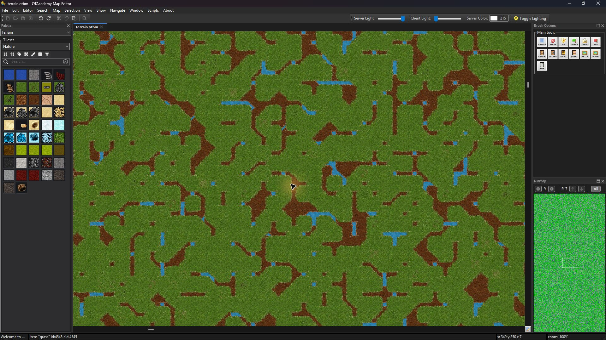
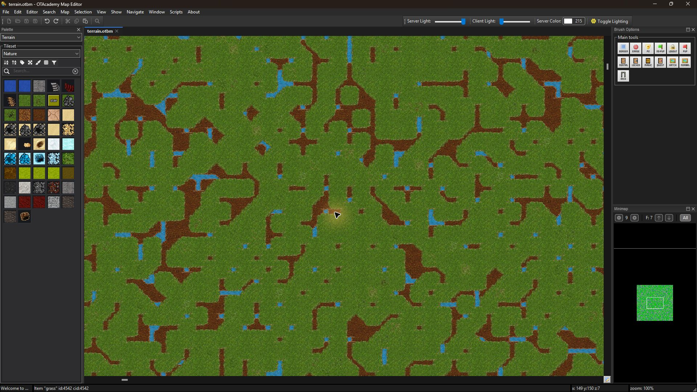

# G1 — write and reopen generated OTBM

<a id="pomiar-place-undo-redo-i-save-dla-100100"></a>

## Place, Undo, Redo and Save timing for 100×100

2026-11-05. Claude Code extended runner, C++ probe, and independent verifier in separate worktree via local bridge (`3f91cfcc-b008-48a0-a480-0591f5da7ec4`). After review three harness files integrated. `build_ninja.bat` passed. SHA-256 of product EXE is `15c25557d955a13831e665b27db793f4086478036fd52025a13cef490d592451`.

In run `g1-place-timing-100-20261105` synthetic OTBM 5 used, private profile 1098-BlackTek, and 512 MiB history limit. Rectangle started at (100, 100, 7). Seed 1729 and weights 3/2/1 used. After Preview and Validate, Place executed via dialog button and Undo, Redo, and Save from menu. Process ended code 0. Verifier in default mode confirmed four measurements, sources, objects, and binaries. Result **PARTIAL_G1_GUI_ROUNDTRIP_TIMING_FOCUS_WARNING** keeps one known `SetFocus` warning.

| Operation | From event to observation [ms] | Max GUI timer break [ms] | Peak working set [MiB] | Working set increment [MiB] | Peak private commit [MiB] | Private commit increment [MiB] |
| --- | ---: | ---: | ---: | ---: | ---: | ---: |
| Place | 84.34 | 113.71 | 728.59 | 6.09 | 570.59 | 7.34 |
| Undo | 48.39 | 88.29 | 728.91 | 0.26 | 570.86 | 0.25 |
| Redo | 41.64 | 65.30 | 729.22 | 0.63 | 571.14 | 0.69 |
| Save | 123.95 | 147.23 | 728.55 | 0.02 | 570.29 | <0.01 |

GUI timer break may start before command. Observer has 20 ms period, largest memory sample interval was 6.46 ms. Results describe one trial. Resource measurements for Preview and Validate on 100×100 on this EXE remain open.

OTBM and five companions saved by probe are byte-identical to kept full 100×100 round-trip. Reopen covers earlier run. [Raw CSV](benchmarks/g1-place-timing-100-20261105.csv) has SHA-256 `6a5b2dab9f66358d7f1065fa0f6a41d362270534016233a1765df89b054bc447`. [Screenshot after Validate](screenshots/g1-place-timing-100-20261105.jpg).

To reproduce, use [runner command](#reproduction) with `--roundtrip-side 100 --roundtrip-timing`, and in verifier select `--roundtrip-timing`. Three historical 500×500 timing runs re-verified with additional `--archived-harness-root local-data/procedural-smoke/g1-timing-500-harness-20261105`. This option requires exact old runner and probe hashes. Remaining hashes checked against current checkout and build. Negative trials rejected changed archived source, wrong size marker, and mismatched side in CSV despite re-computed file hash.

## Place, Undo, Redo and Save timing for 500×500

2026-11-05, single run `g1-place-timing-20261105`. Canonical `build_ninja.bat` ended code 0, EXE `15c25557…`. Private RME probe used synthetic OTBM 5, profile 1098-BlackTek, and 512 MiB history limit. Runner confirmed four rows in order, source freshness, and unchanged assets. Exit code 0, one known `SetFocus` warning, status **PARTIAL_G1_GUI_TIMING_FOCUS_WARNING**.

| Operation | Time to observation [ms] | Max GUI timer break [ms] | Peak WS [MiB] | WS increment [MiB] | Peak private commit [MiB] | Private commit increment [MiB] |
| --- | ---: | ---: | ---: | ---: | ---: | ---: |
| Place | 413.8 | 544.4 | 912.32 | 110.23 | 760.05 | 114.82 |
| Undo | 77.0 | 119.2 | 839.60 | 2.44 | 691.78 | 2.70 |
| Redo | 72.1 | 94.9 | 839.82 | 0.34 | 691.96 | 0.34 |
| Save | 189.6 | 213.3 | 839.41 | 0.04 | 691.50 | 0.10 |

Time starts on Place button event or menu command and ends on first 20 ms timer tick seeing history change or save flag. Timer break may start before command, e.g. during open menu handling. So 544.4 ms break is not Place handler time. Memory sampler runs requested 5 ms interval, largest observed sample interval was 6.53 ms. Peaks are observed values. Each operation increment relates to its own starting state.

This mode skips independent preview and full tile scan. After operation checks history, tile count, and five fixture tiles. Full payload comparison and reopen in separate runs below. One run gives measurement in this environment. Repeatability assessment and resource threshold acceptance remain open.

To reproduce trial use runner command from reproduction section with additional `--roundtrip-side 500 --roundtrip-timing` and fresh directory. After `ROUNDTRIP_FIXTURE_READY` set Width and Height to 500. Execute Preview, Validate and Place on map, then from Edit menu select Undo, then Redo, and from File menu select Save. Wait for marker after each step. After `ROUNDTRIP_TIMING_PASS` close private application. Raw data in `local-data/procedural-smoke/g1-place-timing-20261105/run/roundtrip-timing.csv`, runner result in `verification.json` next to `run` directory.


After run execute `g1_verify_dialog_probe.py OUTPUT --roundtrip-timing`. Verifier compares source, object, and EXE hashes, checks CSV and agreement of its four rows with GUI log. Saved run gave **PARTIAL_G1_GUI_ROUNDTRIP_TIMING_FOCUS_WARNING** in `current-verification.json`. On data copies verifier rejected wrong CSV hash, mismatched time, wrong memory peak, infinite interval, and fractional sample count.

## Rerun 100×100 on current build

Run `g1-roundtrip-100-post-preflight-rme-20261104` on same product build `15c25557…` as latest 500×500 confirmed native Preview → Validate → Place → Undo → Redo → Save → Close → Open. Place created one history entry. RME reread 10,005 tiles. Observer confirmed agreement of all 10,000 generated tiles and preservation of five fixture tiles. OTBM and all five XML have identical hashes as previous 100×100 run.

Verifier checked 421 objects, 421 compile inputs, and unchanged assets. Exit code 0, one deferred `SetFocus` warning, status **PARTIAL_G1_GUI_OTBM5_ROUNDTRIP_FOCUS_WARNING**. Both sizes now have current evidence of OTBM 5 round-trip in RME. This run did not measure memory or responsiveness.

## Rerun 500×500 after preflight fix

2026-11-04. `g1-roundtrip-500-post-preflight-rme-20261104` repeated full sequence on current build `15c25557…`. Native Place took one history entry. Undo and Redo passed, and reread restored all 250,000 generated tiles and five fixture tiles. Verifier confirmed 421 objects, 421 compile inputs, and unchanged assets. Saved OTBM and five XML have identical hashes as previous 500×500 trial.

RME displayed read terrain in renderer and minimap after Go To Position to `(350, 350, 7)`. Process ended code 0 with one deferred `SetFocus` warning, so report keeps status **PARTIAL_G1_GUI_OTBM5_ROUNDTRIP_FOCUS_WARNING**. Run covers 500×500, OTBM 5, and read in RME.



## Full 500×500 path

2026-11-04. In run `g1-roundtrip-500-rme-20261104` operator executed Preview → Validate → Place → Undo → Redo → Save → Close → Open. Place took one history entry. Observer checked agreement of all 250,000 generated tile contents after Place, Redo, save, and read, and after Undo confirmed return to five fixture tiles. Reopened map was clean and had empty history.

Independent verifier confirmed 250,005 tiles, no writes outside rectangle and fixture, identical binary nodes of five fixture tiles, and agreement of five non-empty XML files. Input assets kept hashes. Process returned 0. Two `SetFocus` warnings kept in stderr. Verifier requires full event sequence and data agreement also with these warnings, and execution result marked as **PARTIAL_G1_GUI_OTBM5_ROUNDTRIP_FOCUS_WARNING**.

History limit 512 MiB applied only to private profile. Run kept second preview for comparisons, so memory measurement and GUI break intervals remain in [separate Preview report](G1_CANCEL.md). Binary and file verification in `local-data/procedural-smoke/g1-roundtrip-500-rme-20261104/current-verification.json`.


## Rerun after separating read and RME close

Run `g1-roundtrip-post-modal-rme-20261104` repeated full sequence with same fixture. Observer waited for main window to become active again and left map open for manual inspection. When "Missing creatures" window still visible, observer log ended at `ROUNDTRIP_CLOSED` and stderr already contained `SetFocus` warning. Process close by observer thus not condition for warning occurrence. Exact invocation not determined.

After rejecting import RME reported `Map loaded: terrain.otbm (10005 tiles)`. Observer confirmed contents of all 10,000 generated tiles and fixture metadata. Manual Go To Position to `(150, 150, 7)` showed terrain in sprite renderer and minimap. After manual close process returned 0. Verifier confirmed same hashes of saved OTBM and all five XML as in first run and 421 current objects and 421 compile inputs. Status remains **PARTIAL_G1_GUI_OTBM5_ROUNDTRIP_FOCUS_WARNING**.



## First run

2026-11-04. **PARTIAL_G1_GUI_OTBM5_ROUNDTRIP_FOCUS_WARNING**. Place → Undo → Redo → Save → Close → Open and data comparisons passed. Process ended code 0, and stderr contained one wxWidgets `SetFocus` warning with code `0x00000057`. Warning cause not determined.

## Scope

Private profile 1098-BlackTek and synthetic map OTBM 5. Before generation observer saves separate reference copy with five fixture tiles outside generation area. Map contains house with exit, UID, AID and text on item, separate monster and NPC spawns, waypoint in BOTH mode, and zone on floor 8.

Operator runs in native GUI Preview and Validate of default 100×100 rectangle with seed 1729. Then executes Place, Undo, Redo, Save, Close, and Open. Observer compares concrete payload of 10,000 tiles with independently prepared preview and checks one history step. Reopen should create new map instance with empty history and kept fixture data.

Independent verifier parses both OTBM and five XML pairs. Compares headers, binary metadata, tile locations, complete fixture nodes, and XML data. Comparison ignores XML formatting and attribute order. Scope includes reopen by RME.


## Result

- Place recorded one history step. Undo removed all 10,000 generated tiles, and Redo reproduced their content. After save and reopen observer compared contents of all these tiles, checked fixture data and empty history.
- Independent disk read confirmed 10,005 tiles after save, identical nodes of five fixture tiles, kept binary waypoint and zone data, and matching, non-empty XML of house, monsters, NPCs, waypoints, and zones.
- RME on open offered import of missing creature definition. Import rejected. Observer checked loaded map data and spawns, but run did not evaluate creature rendering or map view after closing this message.
- `build_ninja.bat` and verification of 421 objects and 421 compile inputs passed. Product code and binary remained as in previous step. Evidence and hashes in `local-data/procedural-smoke/g1-roundtrip-final-rme-20261104/current-verification.json`. Earlier trials kept without pass. First build reverted after zone fixture fix, and next run stopped before generation on wrong waypoint key read by observer.

Verification concerns one OTBM 5 scenario, client 1098-BlackTek, and read in RME. Other OTBM versions and readers out of scope. Full **G1 IN PROGRESS**.

## Reproduction

```text
rtk proxy <PY> docs/procedural/smoke/g1_run_dialog_probe.py local-data/procedural-smoke/NEW_RUN local-data/procedural-smoke/g0-reference-profile-20261030/data local-data/procedural-smoke/g0-reference-profile-20261030/config.toml --roundtrip
rtk proxy <PY> docs/procedural/smoke/g1_verify_dialog_probe.py local-data/procedural-smoke/NEW_RUN --roundtrip
```

`<PY>` is `C:/Users/Sorky/.cache/codex-runtimes/codex-primary-runtime/dependencies/python/python.exe -X utf8`. After `ROUNDTRIP_FIXTURE_READY` open Map → Generate terrain. Leave defaults and execute Preview → Validate → Place on map. Wait for marker after each next command: Undo, Redo, Save, Close. Then via Open open only `NEW_RUN/run/generated/terrain.otbm`. If RME asks for creature definition import, select No. After `ROUNDTRIP_PASS` close private RME via File → Exit or Alt+F4.

For 500×500 add `--roundtrip-side 500` to runner and set Width and Height to 500 in dialog. Observer moves fixture outside larger rectangle and sets history limit to 512 MiB only in private instance. Verifier reads size from run results.

## Rerun on current binary (2026-11-06)

Previous full round-trip evidence from EXE `15c25557…`. Current tree gives product EXE `b87d1abb…` (`build_ninja.bat`, code 0); from that build changed among others `terrain_preparation.cpp`, dialog, and save code. So full sequence Place → Undo → Redo → Save → Close → Open repeated in native RME, with operator:

| Run | Size | Observer result | Write | Read | Verifier |
|---|---|---|---|---|---|
| `g1-roundtrip-100-cur-c-20261106` | 100×100 | `ROUNDTRIP_PASS`, code 0 | 0.1 MB in 0.0 s | 10,005 tiles in 5.1 s | `PARTIAL_G1_GUI_OTBM5_ROUNDTRIP_FOCUS_WARNING`: 10,000 generated and 5 protected tiles, five XML companions matching and non-empty |
| `g1-roundtrip-500-cur-20261106` | 500×500 | `ROUNDTRIP_PASS`, code 0 | 3.6 MB in 0.1 s | 250,005 tiles in 2.1 s | `PARTIAL_G1_GUI_OTBM5_ROUNDTRIP_FOCUS_WARNING`: 250,000 generated and 5 protected tiles |

Both runs have known `SetFocus` warning (`0x57`) in stderr, hence partial status. 100×100 run also had four lines of Google Drive shell extension that the Open window loads (not RME output). Verifier now exactly ignores these lines, records them in `ignored_external_stderr`, and still requires rest of stderr to meet existing rules; this is criterion relaxation.

Two earlier 100×100 trials this day did not pass due to operator step order, not product: in `g1-roundtrip-100-cur-20261106` application ended instead of closing map (no Close and Open markers), in `…-cur-b-…` closed map before Save and observer reported `Unexpected map tile count` on second, empty tab. Conclusions based on app logs, not operator action observation. Scope as before: one OTBM 5 scenario, client 1098-BlackTek, read in RME; other OTBM versions and external readers out of scope. Full **G1 IN PROGRESS**.
